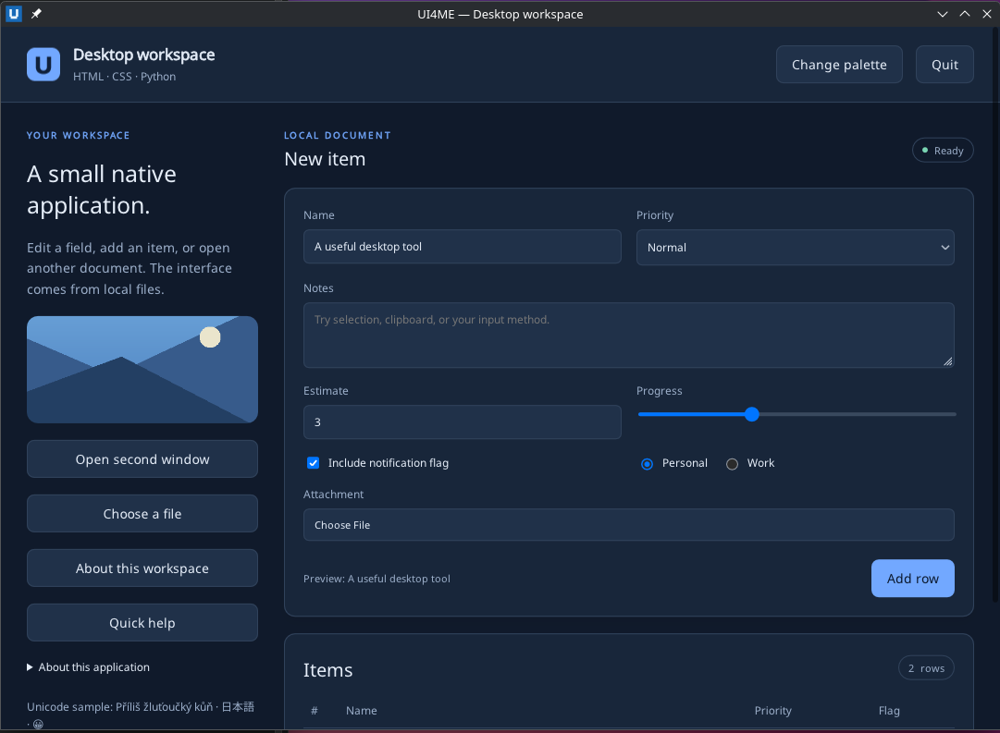
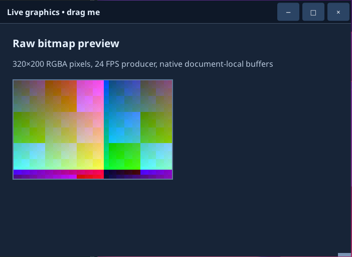

# UI4ME Core

**Build native desktop applications with HTML, CSS and Python—without bundling a browser.**

[](https://github.com/ui4me/ui4me-core/actions/workflows/ci.yml)
[](https://pypi.org/project/ui4me-core/)
[](https://pypi.org/project/ui4me-core/)
[](https://github.com/ui4me/ui4me-core/blob/main/LICENSE)

UI4ME gives Python a familiar HTML/CSS user interface while **Rust owns the real desktop window, input, rendering, accessibility and lifecycle**. Application code runs in a separate, supervised Python process over private local IPC. There is **no Chromium, WebKit, Electron, Qt, embedded webview, JavaScript engine or HTTP server**. It is a focused native HTML/CSS desktop renderer, **not a complete browser**.



*An actual UI4ME window from the Linux native acceptance run. [Live bitmap / custom titlebar screenshot](https://github.com/ui4me/ui4me-core/blob/main/docs/images/live-bitmap.png).*

## Install

Requires **Python 3.10+**, on Linux x86-64 with **glibc 2.34+** or Windows x86-64. The wheels include the native Rust host, so **Rust is not required to install or run** UI4ME.

**Linux** (use a virtual environment):

```bash
python3 -m venv .venv
source .venv/bin/activate
python -m pip install ui4me-core
ui4me-host --version
```

**Windows PowerShell** (same Python API):

```powershell
py -m venv .venv
.\.venv\Scripts\Activate.ps1
python -m pip install ui4me-core
ui4me-host --version
```

The published package name is **`ui4me-core`**; the Python import is **`ui4me_core`**. The same sdist and wheels, with `SHA256SUMS`, are attached to the [GitHub release](https://github.com/ui4me/ui4me-core/releases/tag/v1.0.0). Releases are published by a manually dispatched workflow, never by a push.

## First application (HTML, CSS and Python)

Create a project with four ordinary files and a manifest:

```bash
ui4me-new hello-ui --name "Hello UI4ME"
ui4me-host run --app hello-ui/app.toml
```

The generator creates `index.html`, `style.css`, `app.py` and `app.toml` using your active Python interpreter. **Start the host with `ui4me-host run`**; do not launch `app.py` directly, because the host supplies the private authenticated connection.

An application callback is regular Python:

```python
from pathlib import Path
from ui4me_core import Application

HERE = Path(__file__).resolve().parent

with Application.from_environment() as app:
    window = app.open_file(HERE / "index.html", title="My first native app")
    doc = window.document

    doc.on("click", lambda event: doc.set_text("status", "Saved!"), element="save")
    app.run()
```

In your HTML, use `<button id="save">Save</button><p id="status">Ready</p>` and link a local CSS file. **No JavaScript or `onclick=` is necessary.**

Generate HTML in Python without an HTML file when you want:

```python
window = app.open_html('<button id="run">Run</button><p id="out">Ready</p>')
window.document.on('click', lambda _: window.document.set_text('out', 'Done'), element='run')
```

You can also replace a loaded document with `window.load_file(...)` or `window.load_html(...)`, update individual elements without reloading, and group changes with `doc.batch([...])`. Old document/node handles are invalid after replacement.

**[5-minute quickstart](https://github.com/ui4me/ui4me-core/blob/main/docs/guides/quickstart.md)** · **[Python API reference](https://github.com/ui4me/ui4me-core/blob/main/docs/reference/python-api.md)** · **[Examples](https://github.com/ui4me/ui4me-core/blob/main/examples/python/README.md)**

## Make your coding agent understand UI4ME

The distribution includes the **`ui4me-python` Agent Skill**. It documents loading HTML from files and strings, callbacks, document changes, stylesheet updates, forms, native dialogs, live bitmaps and the correct host launch model. Install it in user-level skill folders for your agents with **one Python command**:

**Linux:**

```bash
python3 -m ui4me_core.skills install --agents all
```

**Windows PowerShell:**

```powershell
py -m ui4me_core.skills install --agents all
```

That installs into the appropriate per-user locations for Claude Code, Codex, OpenCode, GitHub Copilot, Cursor and Gemini CLI. No administrator privileges are needed; no other skills are overwritten. To inspect the destinations first:

```bash
ui4me-skill install --agents all --dry-run
ui4me-skill status --agents all
```

There is no universal skill directory supported by every agent; the installer handles agent-specific locations. [Agent Skills guide](https://github.com/ui4me/ui4me-core/blob/main/docs/guides/agent-skills.md) · [Skill source](https://github.com/ui4me/ui4me-core/blob/main/skills/ui4me-python/SKILL.md).

## Why UI4ME?

| Feature | What it enables |
| --- | --- |
| **Native windows** | Normal taskbar, focus, desktop dialogs, clipboard, drag-and-drop, DPI, keyboard and IME integration. |
| **Real HTML/CSS** | Local files, common CSS selectors, variables, fonts, flex/grid/tables, scrolling, controls, responsive layout and styled content. |
| **Python callbacks** | Handle events, mutate text/attributes/classes, use atomic batches and control forms without JavaScript. |
| **Custom chrome** | Frameless windows with HTML/CSS titlebars, native dragging, edge resize and custom minimize/maximize/close buttons. |
| **Live image surfaces** | Present RGBA frames for generated graphics, previews and visualizations using bounded shared buffers. |
| **Independent app logic** | Slow Python work does not own or block the native event loop; the host supervises the backend process. |
| **Installable binary wheels** | One `py3-none` wheel per supported platform, with the Rust executable included. |



*The same native engine displaying continuously updated pixels through a mapped bitmap surface.*

## Platform support and limits

| Platform | Qualification |
| --- | --- |
| **Linux x86-64, glibc 2.34+** | Tested on Debian 13 / KDE Plasma 6.3 / native Wayland |
| **Windows x86-64** | Tested on Windows Server 2022 Desktop Experience in an interactive RDP session |
| macOS, X11, ARM64, additional Windows configurations | Not qualified for 1.0.0 |

UI4ME deliberately supports a finite desktop HTML/CSS profile. **It is not a browser:** no page JavaScript, fetch/network navigation, browser extensions, HTML media, full interactive SVG, PDF/printing engine or full rich-text editor. Some native window requests differ between Wayland and Windows; the API reports unsupported operations rather than claiming success. [Read platform limitations](https://github.com/ui4me/ui4me-core/blob/main/docs/guides/platforms.md) and the [capability audit](https://github.com/ui4me/ui4me-core/blob/main/docs/CAPABILITY_SCOPE.md).

## More ways to use it

- **Atomic updates:** `doc.batch([{"op": "set_text", "element": "status", "text": "Ready"}, ...])`.
- **Native dialogs:** `window.open_files()`, `window.save_file()` and `window.choose_folder()`.
- **Generated resources:** `doc.register_resources("icons", {"ok.png": image_bytes})` for `ui4me-res://icons/ok.png`.
- **Live pixels:** `` with `doc.create_bitmap("preview", 320, 200)` and `bitmap.try_present(raw_rgba)`.
- **Multiple windows:** `app.open_file(...)`, `app.open_html(...)` and `window.load_html(...)`.
- **Native window control:** `app.create_window(decorations=False)` with `data-ui4me-drag` and `data-ui4me-resize` in HTML.

[Patterns and recipes](https://github.com/ui4me/ui4me-core/blob/main/docs/guides/patterns.md) · [Technical protocol](https://github.com/ui4me/ui4me-core/blob/main/docs/PROTOCOL_DOCUMENTS.md) · [Core architecture](https://github.com/ui4me/ui4me-core/blob/main/docs/CORE_1.0_SPEC.md).

## Development and releases

Run the source checks (requires Rust and native development dependencies):

```bash
python3 tools/verify.py
cargo clippy --locked --workspace --all-targets -- -D warnings
```

The project includes installed-release acceptance scenarios for Linux and Windows. CI checks builds/contracts; the native KDE/Windows qualification records are in [docs/STATUS.md](https://github.com/ui4me/ui4me-core/blob/main/docs/STATUS.md).

**Publishing is manual and intentional.** [`.github/workflows/publish.yaml`](https://github.com/ui4me/ui4me-core/blob/main/.github/workflows/publish.yaml) assembles the sdist, manylinux wheel and Windows wheel from one commit, validates them, publishes using PyPI Trusted Publishing, then creates the GitHub release. A regular push or tag does **not** publish. [Release instructions](https://github.com/ui4me/ui4me-core/blob/main/docs/release/PUBLISHING.md).

[Documentation index](https://github.com/ui4me/ui4me-core/blob/main/docs/index.md) · [Contributing](https://github.com/ui4me/ui4me-core/blob/main/CONTRIBUTING.md) · [Third-party notices](https://github.com/ui4me/ui4me-core/blob/main/THIRD_PARTY_NOTICES.md) · [License](https://github.com/ui4me/ui4me-core/blob/main/LICENSE)
