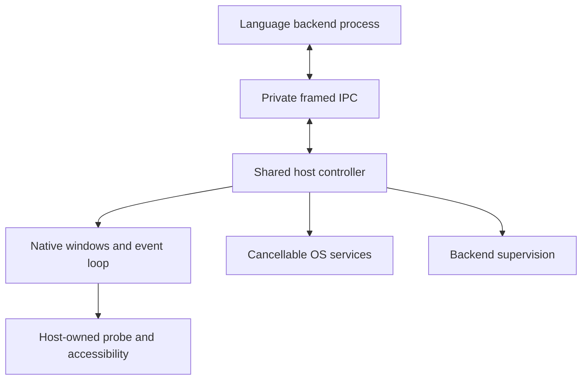
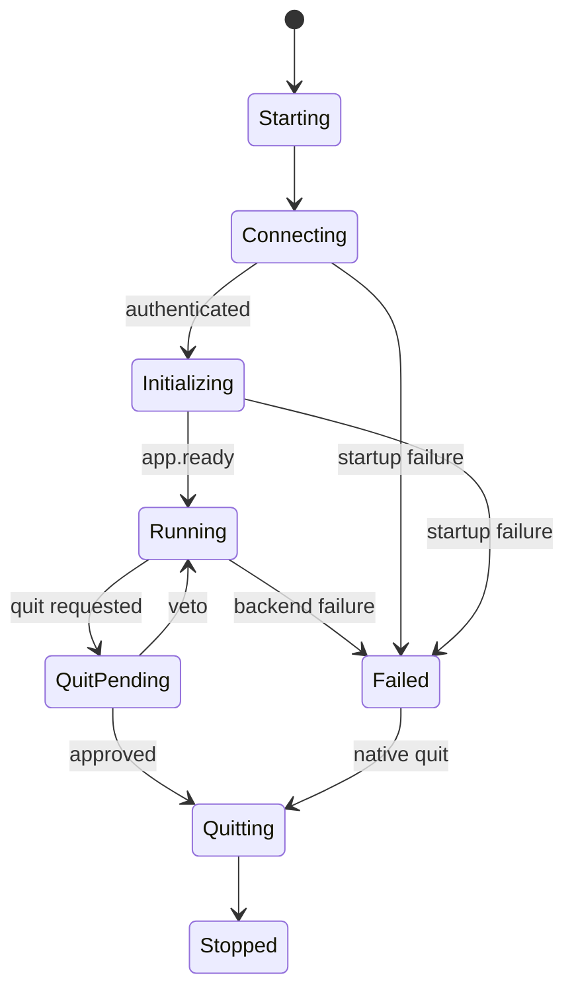

# UI4ME host 0.1 — architecture and requirements

## Product boundary

The host is the operating-system foundation of a desktop application builder.
It owns application lifetime, native windows, trusted local communication,
managed backend processes and desktop services. The host is a normal foreground
desktop application, with at least one window before app.ready.

There is one Cargo package. Platform modules are internal adapters, not separate
public crates. A single executable owns the main native event loop. Each running
application has one separate language backend. The included Python code is a
reference protocol implementation, not a public SDK release.

The previous UI4ME APIs impose no compatibility constraints. Protocol version 1
describes this package; only version 1 is accepted at handshake. Future changes
must be explicit rather than silently changing the meaning of an existing field.

## Required platforms

| Target | Native integration | Qualification environment |
| --- | --- | --- |
| Linux | Wayland, session D-Bus, desktop portals, systemd user manager, AT-SPI | Debian/KDE native Wayland session |
| Windows | Win32, private named pipes, Job Objects, native common file dialogs, UI Automation | Windows Server 2022 Desktop Experience, normal user in interactive RDP session |
| macOS | Adapter not implemented in v0.1 | Later |
| X11 | Not compiled as a fallback | Later only if deliberately added |

Both required targets share the same protocol and lifecycle policy. A method
whose native capability is unavailable returns an explicit error. A headless
test must not report a working clipboard, native window or accessibility bridge.

## Components and ownership

The controller owns window identities, lifecycle phase, pending decisions and
pending service requests. Only the GUI thread creates or changes windows.
Transport readers/writers, native dialog workers and backend log readers deliver
bounded messages and wake the event loop; they do not mutate window state.

The backend owns application logic. It does not own the host's event loop, native
window handle or accessibility tree. A blocked callback can delay a business
decision but cannot block native input and redraw. There is no synchronous
host-to-backend call on the GUI thread.

Presentation currently consists of a CPU test surface. The future renderer will
replace this surface and its semantic tree producer while continuing to use
the existing native window, event, IME, focus and accessibility boundaries.
There is deliberately no plugin ABI or renderer registry before a second real
presentation implementation exists.

## Application state

Startup has a configurable deadline. Failure to authenticate and call app.ready
is an application failure, with a nonzero exit in headless mode and a host-owned
error view on a native desktop. Closing during startup cancels startup with a
bounded shutdown rather than waiting for an unready backend to approve it.

Window close and application quit are different decisions:

- Closing one window calls window.before_close.
- Application quit calls app.before_quit once for the whole application.
- Application quit supersedes outstanding window-close decisions, without
  destroying any window. A late answer to a superseded decision is ignored.
- A veto leaves the affected window or application intact.
- Closing the final window also needs application quit approval before the
  application loses its last window.
- Window creation is frozen during application quit preflight. Existing
  application work can finish, including save dialogs.
- Approved quit sends app.shutdown, cancels native requests and gives the
  backend the configured grace period. Exceeding it forces cleanup and reports
  an unsuccessful shutdown.

A hung decision is not automatically treated as consent to lose application
state. The native probe remains usable and exposes the Ctrl+Shift+Q emergency
shutdown action. Backend failure shows local diagnostics and a working native
quit action.

## Process containment

### Linux

Normal launch re-enters the host through a transient systemd user service.
The host is the service's main process. ExitType=main,
KillMode=control-group and a stop timeout tie backend and descendant cleanup
to the host's lifetime, including abrupt host death. The launcher passes
environment **names** to systemd-run, not secret values in argv.

The original desktop realm is preserved across re-entry. A desktop-session
instance lock prevents another desktop session or a different user from
accidentally sharing another application's endpoint.

Test/explicit diagnostic mode uses a process group and direct child cleanup.
It cannot promise cleanup after the host itself is killed, and reports that
limitation in capabilities. Native qualification requires normal supervision.

### Windows

The backend is assigned to a kill-on-close Job Object **during process creation**,
using the process attribute list. The child therefore cannot execute between
creation and assignment. Only the intended standard handles are inherited.
The job handle is private to the host and is not inherited by the backend.
Dropping the last job handle terminates the job's managed process tree.

Application launch and qualification must use a normal user token. The host
inherits its launch token; it does not automatically de-elevate an administrator
launch. Administrative access in the test lab is for provisioning.

### External applications

Opening a browser, document or folder is an OS broker operation. Those external
applications do not become managed backend descendants. Linux uses the
desktop OpenURI portal; Windows uses the native shell. An accepted request
means the OS accepted the handoff, not proof that the destination displayed UI.

## Transport and concurrency

Unix-domain sockets live in a checked, owner-only runtime directory. Windows
named pipes are restricted to the current logon SID and reject remote clients.
The endpoint is local and session-scoped. There is no HTTP server or TCP port.

The backend receives a fresh random credential in its inherited environment and
must authenticate before controlling windows or services. Secondary launch
activation is separately accepted from the current user's private endpoint and
only forwards launch data and requests focus.

Limits are deliberate: a 2 MiB frame, bounded IDs and method names, bounded
incoming/outgoing bytes, bounded peer counts and pending requests, bounded log
storage and native worker counts. Large events cannot allocate unlimited queues.
Control/disconnect processing stays nonblocking under queue saturation.

Native data transfer has a separate limitation: the host accepts at most 1 MiB
of clipboard/transfer content, but this check runs after upstream winit retrieves
the native payload. The pinned Wayland implementation can allocate that payload
before the host receives it. The IPC limits therefore do not provide a hard
memory bound on upstream native transfer allocation.

User stdout/stderr are log streams, not the protocol transport. Reader threads
drain them into a fixed-size ring and report dropped records. An application that
prints heavily cannot deadlock the host by filling an undrained pipe.

GUI work is bounded per event-loop turn. The controller processes a limited
number of protocol, worker and accessibility messages, then yields to native
events. A short timer observes process exit and deadlines even when no external
event arrives.

## Window and desktop contracts

- Window IDs are opaque and process-local. Use them instead of native handles.
- Requested dimensions are logical units. Physical surface size and scale
  factor are reported separately; the compositor can constrain requested sizes.
- Focus is a request. Wayland focus-stealing and placement policy remain under
  compositor control. Absolute top-level positioning returns unsupported there.
- Clipboard supports bounded plain text. Wayland ownership can require an
  active window and a real user interaction serial; this must be tested on KDE.
- Dialogs have a real native parent. The parent stays alive until native dialog
  teardown. Cancellation invokes portal Request.Close or Windows
  IFileDialog::Close on the dialog's owning apartment.
- File selection returns local paths and a cancellation flag. Save selection
  does not itself write a file.
- External open is limited to absolute paths and http, https, mailto and file
  schemes. Inputs are data; no shell command string is assembled from them.
- Application paths are returned without creating application data directories
  on the backend's behalf.
- File drag/drop emits Unicode local paths, and text drops emit plain text.
  The test surface is not a general drag-and-drop widget system.

## Text and accessibility probe

The probe's small editor tests cursor/selection, keyboard navigation,
clipboard, IME preedit and commit, surrounding-text updates and
delete-surrounding requests. Internal selection offsets are UTF-8 bytes.
Keyboard movement and unselected deletion use grapheme boundaries; mouse and
accessibility selection can use Unicode scalar boundaries. The IME receives a bounded excerpt
with valid character boundaries and a native caret rectangle.

Accessibility callbacks read a host-owned cached tree synchronously.
Focus, value, selection and button actions are queued back to the GUI thread.
The Linux adapter exports AT-SPI, and the Windows adapter exposes UI Automation.
No accessibility callback waits for Python.

The CPU probe's visual text rendering is intentionally limited. It uses a
bundled Noto Sans font, does not perform complex shaping, and does not qualify
as the future HTML/CSS engine. Correct storage and delivery of Unicode input
must not be confused with full typography support.

## Dependency choices

The dependency graph is locked. The windowing layer is pinned exactly to
winit 0.31.0-beta.4 because its cross-platform data-transfer and expanded IME
APIs are used directly. **This is a prerelease dependency and a material
stabilization risk.** Local qualification must exercise those APIs, and any
version change needs targeted native regression checks.

AccessKit's Unix and Windows adapters are used directly so the code does not
pull in a second, older winit through accesskit_winit. Softbuffer provides the
small CPU presentation target. ashpd is used for Wayland parent export; the
file chooser request/cancellation is implemented against the portal protocol.
Windows services call the public Windows APIs through the windows crates.

The host does not embed the Tauri application runtime: that runtime's principal
webview ownership assumptions do not match this renderer-independent host.
Reusing focused upstream libraries keeps the ownership model explicit.

## Acceptance and release gate

tools/native_acceptance.py defines the mandatory native scenarios and stores
evidence per target. Both Linux/KDE and Windows/RDP must pass, including real
input/IME, accessibility actions, clipboard with another application, dialog
parenting/cancellation, DPI, activation, failure responsiveness, managed worker
cleanup and external application survival.

Compilation, a unit test, a moving window, an RDP screenshot or a restarted VM
does not prove all these behaviors. An interrupted native check is rerun after
recovery. A blocking mandatory defect is fixed, not relabeled out of scope.

## Deliberately outside 0.1

HTML/CSS/SVG rendering; DOM and component APIs; rich typography; public SDK
packaging; JavaScript or browser integration; printing/PDF; tray and background
applications; notifications; global shortcuts; updater/autostart; arbitrary
plugins; custom modal widget/window systems; and macOS/X11 adapters.

These are separate future decisions. None is required to validate the
foreground host's ownership and operating-system contracts.
