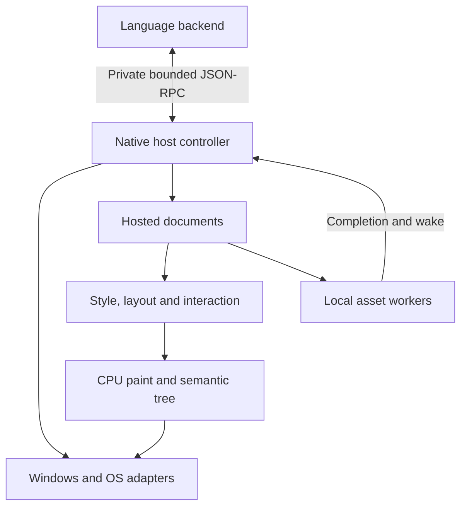

# UI4ME Core architecture and requirements

Core 1.0 completion requirements and explicit audit dispositions are in
[CORE_1.0_SPEC](CORE_1.0_SPEC.md); its protocol extensions are in
[CORE_1.0_PROTOCOL](CORE_1.0_PROTOCOL.md). This file retains the common foundation.

## Product boundary

UI4ME is a native desktop application builder with an HTML/CSS front end and a
separate programming-language backend. The existing engine is integrated with
the native host. Core 1.0 completes the selected application API and desktop
profile, followed by fixes and qualification. It does not introduce a component framework,
a browser runtime, a second native host, or a separate rendering process.

Application code may change APIs freely at this stage. Retaining the existing
host transport is an implementation choice that preserves tested behavior, not
a compatibility commitment to a public ecosystem.

## Ownership

The host's GUI thread exclusively owns the event loop, windows, presentation
surfaces, document engines and mutable interaction state. The backend owns app
logic and receives events; it does not render, run a native loop or call platform
APIs through the renderer. Asset and native-service workers return results to
the owner thread. Each completion carries the document identity where relevant.

The host maintains one presentation context. Each native window has at most one
loaded document or the diagnostic probe. A replacement is parsed and validated
before the old document is removed. At most sixteen documents are installed;
a replacement may transiently allocate a seventeenth while the old one is still
available for rollback.

The four engine packages are internal workspace boundaries, not independently
published products. Host ownership and the platform adapters stay in
`ui4me-host`. The previous monolithic engine application runtime and C ABI are
not included.

## Lifecycle and supervision

The native-service contracts, application state machine, launcher ownership,
shutdown deadlines, close/quit decisions, session-aware single-instance routing
and process containment are retained from [HOST_0.1_SPEC](HOST_0.1_SPEC.md).
That document describes the historical host foundation; references there to an
absent renderer are superseded by this specification.

On Linux, the launcher uses a systemd user service for the host/backend tree.
On Windows, the host uses a Job Object and the interactive user's desktop.
Backend failure cannot take control of the native event loop. The host retains
a local failure surface and Ctrl+Shift+Q emergency shutdown. Native dialogs
must be cancelled before destroying their parent. External applications opened
by the shell remain outside the managed backend tree.

The renderer's native integration uses these existing services. File inputs
request the host's picker; editing requests the host's plain-text clipboard;
accessibility uses the host's AccessKit adapter. No platform implementation is
duplicated inside the scripting bindings.

## Documents and protocol

The private wire protocol remains length-bounded JSON-RPC. `document.load`,
`document.get`, `document.unload` and `document.command` are typed at the Rust
boundary. See [PROTOCOL_DOCUMENTS](PROTOCOL_DOCUMENTS.md) for the exact operations.
Unknown operations/fields fail explicitly; the backend cannot tunnel arbitrary
internal renderer commands through the host.

A document has a monotonically allocated host identity. Every mutation names
both the window and document, and every document event includes both. Node
identities also contain generation information. A replaced document cannot be
mutated by an old request, clipboard read, picker, accessibility action or drop.
Mutation batches validate before commit; a rejected batch does not apply its
prefix. File and string loads use the same hosted feature profile.

Local HTML files are UTF-8 and at most 1 MiB. File loads default to an asset root
at the file's directory; string loads need an explicit asset root for local
assets. The resource layer enforces canonical local resolution, traversal and
symlink handling, content bounds and lifecycle cancellation. The backend is
trusted local application code, so this is not a sandbox for hostile web pages.

DOM events are asynchronous notifications. A backend may update the document
from a callback, but cannot return a synchronous browser-style `preventDefault`
after the native operation has completed. Supported cancellation rules are
registered in advance with `set_default_action`. Native editing, focus and
painting stay on the host thread even if backend callbacks are slow.

## Screen rendering profile

The hosted profile is `ui4me-desktop-1.0`. It carries the donor's implemented
screen CSS, selectors, cascade, layout, text and interaction code rather than
replacing it with a new minimal engine. The runtime `css_profile` and diagnostics
report the actual supported/degraded features. This is not an assertion of full
browser conformance.

The intended baseline comprises ordinary block/flex/grid/table layouts,
responsive sizing, local stylesheets, local fonts and images, static SVG,
Unicode shaping/fallback, scrolling, focus, forms, selection, supported CSS
transitions/animations, semantic accessibility and dynamic DOM updates.

Excluded public capabilities: printing, PDF and pagination; editable rich HTML;
HTML clipboard; interactive SVG shape trees; JavaScript; web navigation/HTTP;
GPU; trays, notifications and other new desktop services; alternate native
application runtimes; new language bindings beyond the reference Python facade.
Internal donor helper code may remain for engine regressions, but every hosted
document uses `Document::parse_hosted`; excluded capabilities are not reachable
from the application protocol. Contenteditable is rejected on initial load and
later DOM/attribute mutation. Page rules are inert for screen rendering and
page-output commands are absent. A static SVG is an image-level event target.

## Native input and accessibility

Pointer coordinates enter the engine in CSS pixels. Physical presentation and
native scale changes update the viewport; primary pointer input supports mouse
and equivalent primary pen/touch actions. Multi-touch gesture qualification is
not part of Core 1.0 qualification. Keyboard events carry logical keys, physical codes and modifier
state. Text insertion observes IME composition and shortcut/AltGr distinctions.

IME exposes a bounded UTF-8 surrounding-text excerpt with byte-aligned cursor
and anchor offsets. Password controls provide empty surrounding text and
sensitive-data hints. Delete-surrounding validates UTF-8 boundaries. Preedit
resets and document replacement invalidate late composition work. Actual
platform behavior must be observed on both target desktops.

Clipboard reads/writes use the host's asynchronous native services. Failed copy
or cut writes cannot silently delete selected text. Delayed pastes/cuts validate
focus, node generation, control value and selection before modifying the target.
Incoming OS drops become document events with a captured target and file paths/plain
text only where `data-ui4me-drop` opts in. Paths are not silently truncated or
opened automatically. Async completion revalidates the original target generation.

Each native AccessKit adapter has a stable window root and never-reused native
child identities. Renderer-local node IDs are mapped per document; action
callbacks are reverse-mapped and stamped with the document epoch before being
queued. Full synchronous trees remain available on accessibility activation;
changed-node publications update an already active client. The old adapter
teardown fix and renderer expanded/invalid mappings are both preserved.

## Resource and scheduling limits

| Boundary | Policy |
| --- | --- |
| Protocol frame | 2 MiB including JSON encoding and envelope |
| HTML source | 1 MiB UTF-8 |
| Installed documents | 16; temporary old+new allocation during replacement |
| Raster assets per document | 32 MiB decoded budget; 16 MiB unused cache within that budget |
| SVG raster cache per document | 16 MiB separately bounded |
| Native text clipboard | 1 MiB; bounded transfers/deadlines |
| Clipboard requests per document | 16 pending; stale requests cancelled |
| File selection/drop | Up to 1024 paths; errors instead of silent truncation |
| Frame pixels | Renderer `MAX_PIXELS` bound; zero-sized surfaces defer painting |
| Inspection/results | Bounded frames; paginated HTML/node/query results |

The sum of raster/SVG asset budgets can reach 768 MiB with sixteen documents.
This is a worst-case allowance, not eager allocation or total process memory.
Frames, native compositor buffers, fonts, DOM/layout and dependencies have
additional costs. Measure the real renderer application; the 0.1 probe's memory
figures are not a 0.2 estimate.

Asset completions wake the host. Animation, scroll and caret deadlines shorten
the native wait interval; otherwise the existing host backs off to its idle
interval. Before rendering a frame, the host acquires a softbuffer back buffer.
If a Wayland compositor still holds all bounded buffers, the frame is deferred
without clearing the document's repaint state or blocking input/IPC.

## Platform and release gate

Linux native Wayland/KDE and Windows Server 2022 Desktop Experience are peers
in the architecture and both are required for the release claim. Windows GUI
tests run in the normal user's actual RDP session; a cross-target source check
or SSH-only process does not substitute for it. macOS adapters are later work.

A source package is complete when it contains the renderer integration,
application example, installer, regression checks and finishing instructions.
It is locally qualified only after the final source tree passes automated checks,
all fifteen historical host scenarios and all renderer scenarios on both
platforms. Record source hashes, commands, platform/session, outcomes and evidence.
Any fix invalidates the affected results and triggers the relevant reruns.
Do not substitute a successful build, screenshot, inherited 0.1 ledger, or
browser-reference generation for observed native behavior.
