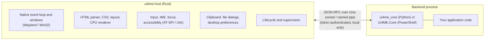
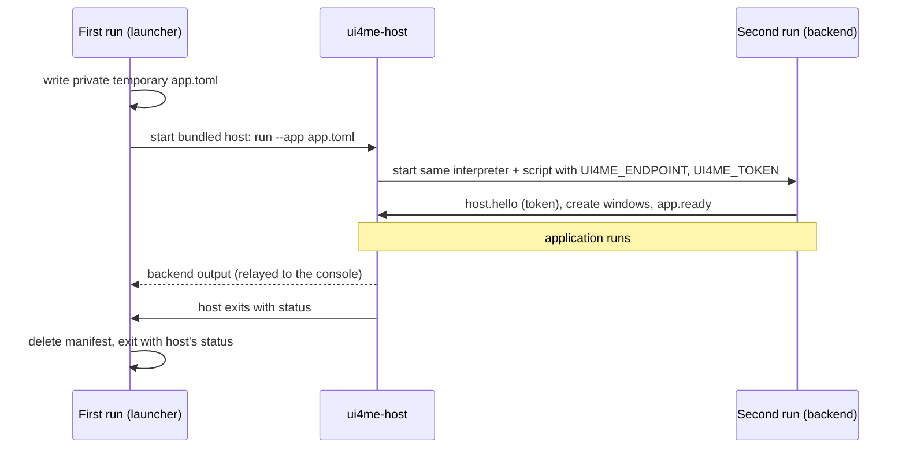

# Architecture

A UI4ME application is two processes: a native **host** written in Rust, and your application **backend** written in Python or PowerShell. They talk over a private, authenticated local connection.

## Who owns what

| Host (`ui4me-host`) | Backend (your process) |
| --- | --- |
| Native top-level windows and the platform event loop | Application state and business logic |
| HTML parsing, CSS cascade, layout, CPU rasterization and presentation | Building HTML, choosing what to show |
| Keyboard, pointer, IME, focus, text editing, scrolling, selection | Reacting to events (`click`, `input`, `submit`, …) |
| Accessibility tree for AT-SPI (Linux) and UI Automation (Windows) | Semantic HTML and ARIA in the markup |
| Clipboard, file dialogs, open/reveal, desktop preferences | Deciding when to call them |
| Startup deadline, close and quit decisions, shutdown deadline | Answering close/quit requests, exiting on shutdown |

Rendering, input and accessibility keep working while the backend is busy: the host never waits on the backend inside a native callback. Events are delivered to the backend as notifications, and the backend changes the page through requests such as `document.command`. The wire format is described in the [protocol reference](../reference/protocol.md); applications use the Python or PowerShell API instead.

## Why there is no browser or JavaScript

A desktop tool needs a layout and styling language, native windows, input, accessibility and a way to run its logic. UI4ME takes HTML and CSS for the first, implements the rest natively, and runs the logic in Python or PowerShell. Without a browser engine there is no JavaScript runtime, no web security model to configure and no network stack. The renderer reads local files and registered in-memory resources only. The supported subset is described in [HTML and CSS scope](html-css-scope.md).

## Supervision

The host starts the backend as its child and is responsible for ending it.

* **Linux:** `ui4me-host run` re-launches itself under a transient `systemd-run --user` service with `KillMode=control-group`, so the host and backend are stopped together even if the host dies. The backend runs in its own session with a parent-death signal. `--allow-unsupervised` turns this off for diagnostics only.
* **Windows:** the backend is created inside a Job Object with *kill on job close*; when the host exits, the backend ends.

The host enforces `startup_timeout_ms` (authenticate and send `app.ready`) and `shutdown_timeout_ms` (exit after `app.shutdown`) from the manifest, and kills a backend that overruns them. If the backend crashes or disconnects, the host shows the failure in its window and, once that window is closed, exits with status 1. Backend stdout and stderr go to bounded host buffers, so console output can never be confused with protocol traffic. Details: [host CLI and manifest](../reference/host-cli.md), [lifecycle](lifecycle.md).

## Direct startup

`python app.py`, `uv run app.py` and `pwsh -File app.ps1` start an app without a manifest. `Application.start()` (Python) and `Start-UI4MEScript` (PowerShell) make this work by running the same script in two roles:

1. **First run (launcher).** No `UI4ME_ENDPOINT`/`UI4ME_TOKEN` in the environment. The launcher writes a manifest into a private temporary `ui4me-start-*` folder that names the current interpreter (`sys.executable`, or `pwsh`/`powershell.exe` from `$PSHOME`), the script and its arguments, and the current directory. It starts the bundled host, relays its output to the console, waits, deletes the folder and exits with the host's exit status. It never reaches the code after the start call.
2. **Second run (backend).** The host starts the same script with `UI4ME_ENDPOINT` and `UI4ME_TOKEN`. The start call connects, authenticates, removes the variables from the process environment and returns the application object.

Everything before the start call runs in both processes, so keep side effects after it. If only one of the two variables is set, or the launcher's marker is present without a connection, startup fails instead of starting a second host. The launcher binds the host's lifetime to its own (parent-death signal on Linux, a kill-on-close job on Windows), so Ctrl+C or closing the terminal stops the host and therefore the backend.

The same host, protocol and supervision are used for direct start and for an explicit `ui4me-host run --app app.toml`.

## Security boundaries

* **Local only.** The host listens on a Unix socket inside a `0700` per-user runtime directory (`$XDG_RUNTIME_DIR/ui4me-host`) or on a named pipe that rejects remote clients and is restricted to the current logon session. There is no TCP listener.
* **Authenticated.** Each launch generates a 256-bit random token, passed only in the backend's environment. The first request must be `host.hello` with that token and protocol version 1. Only one backend connection is accepted.
* **Bounded.** Frames are limited to 2 MiB, pending requests to 128, HTML to 1 MiB per document, and queues, logs and resources have fixed budgets.
* **No network, no scripts.** The renderer never fetches `http(s)` resources and never executes code from a page. External links are handed to the desktop (`desktop.open_external`) only when the application asks.
* **Not a sandbox.** The backend runs with the user's normal permissions. Insert only trusted markup with HTML-inserting operations and use the text operations for user-provided content.
