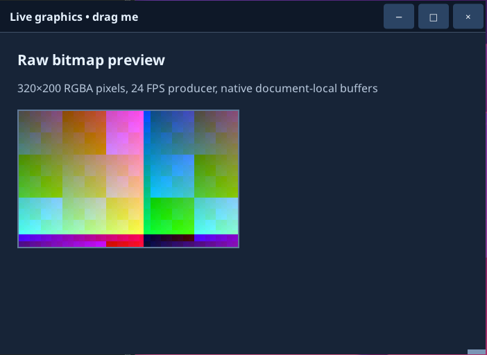

# PowerShell recipes

Ready-to-adapt recipes for common desktop-app tasks, written for the `UI4ME.Core` PowerShell module. Each one is a complete program: save it as `app.ps1` and run `pwsh -File ./app.ps1` (PowerShell 7.2+ on Linux or Windows) or `powershell.exe -NoProfile -File .\app.ps1` (Windows PowerShell 5.1). Every recipe works in both shells. The HTML is inline to keep the examples short; in a real project put it in `index.html` and `style.css` and use `Open-UI4MEFile` (recipe 6). The same recipes for Python are in [Python recipes](patterns.md).

A few rules apply to every recipe:

- Behavior lives in PowerShell scriptblocks registered with `Register-UI4MEDocumentEvent`. There is no JavaScript: HTML containing `<script>` or `onclick=`-style attributes is rejected when it loads.
- Code above `Start-UI4MEScript` runs twice (once in the launcher, once in the backend). Keep only `$ErrorActionPreference`, `Import-Module` and plain assignments such as the HTML strings there; put everything else below the call.
- Callbacks run on your script's own runspace, one at a time, *after* the native action already happened. They run while the script **pumps**: inside `Wait-UI4ME`, and inside any UI4ME command that waits for the host's reply. Never call UI4ME commands from jobs, runspaces or threads.
- A callback runs in a child scope of your script. It can *read* script variables (`$doc`, `$window`, a hashtable), but to *assign* one, write `$script:name = ...`; a plain `$name = ...` only creates a local copy that disappears when the callback returns. Changing a property of a shared hashtable (`$state.dirty = $true`) needs no prefix.
- Commands that return a value you do not need are discarded with `$null = ...`. In a backend, stray output is printed to the terminal.
- The recipes are plain ASCII. If you add non-ASCII text, save the `.ps1` as UTF-8 **with BOM**, or Windows PowerShell 5.1 reads it as the ANSI code page.

Every command used here is described in the [PowerShell command reference](../reference/powershell-api.md).

## Contents

1. [Respond to a button](#1-respond-to-a-button)
2. [Read a form](#2-read-a-form)
3. [Handle many items with one callback](#3-handle-many-items-with-one-callback)
4. [Update several elements at once](#4-update-several-elements-at-once)
5. [Switch screens by replacing the document](#5-switch-screens-by-replacing-the-document)
6. [Load HTML and CSS files](#6-load-html-and-css-files)
7. [Change styles at runtime](#7-change-styles-at-runtime)
8. [Follow the desktop's light/dark preference](#8-follow-the-desktops-lightdark-preference)
9. [Open and save files with native dialogs](#9-open-and-save-files-with-native-dialogs)
10. [Copy and paste](#10-copy-and-paste)
11. [Ask before closing](#11-ask-before-closing)
12. [Run slow work without freezing events](#12-run-slow-work-without-freezing-events)
13. [Stream pixels with a live bitmap](#13-stream-pixels-with-a-live-bitmap)
14. [Work with elements that have no id](#14-work-with-elements-that-have-no-id)
15. [Keyboard shortcuts](#15-keyboard-shortcuts)

## 1. Respond to a button

```powershell
$ErrorActionPreference = 'Stop'
Import-Module UI4ME.Core

$html = @'
<button id="save">Save</button>
<p id="status" role="status">Not saved</p>
'@

$app = Start-UI4MEScript -Name 'Button demo'
$window = New-UI4MEWindow -Application $app -Title 'Button demo' -Width 400 -Height 200
$doc = Open-UI4MEHtml -Window $window -Html $html

$null = Register-UI4MEDocumentEvent -Document $doc -Type click -Element save -Callback {
    Set-UI4MEDocumentText -Document $doc -Element status -Text 'Saved'
}

Set-UI4MEReady -Application $app
Wait-UI4ME -Application $app -UntilShutdown
Close-UI4ME -Application $app
```

`-Element save` is the button's `id`. `Set-UI4MEDocumentText` always inserts plain text, so it is safe for anything the user typed. `Register-UI4MEDocumentEvent` returns a subscription; keep it if you want to remove the callback later with `Unregister-UI4MEDocumentEvent`.

## 2. Read a form

Prevent the form's native submission in advance, then handle `submit` in PowerShell. Calling `Set-UI4MEPreventDefault` inside the callback would be too late, because events arrive after the native action.

```powershell
$ErrorActionPreference = 'Stop'
Import-Module UI4ME.Core

$html = @'
<form id="signup">
  <label for="person">Name</label>
  <input id="person" name="person" type="text" required>
  <label><input id="news" name="news" type="checkbox"> Send me news</label>
  <button id="send" type="submit">Sign up</button>
</form>
<p id="result" role="status">Waiting</p>
'@

$app = Start-UI4MEScript -Name 'Form demo'
$window = New-UI4MEWindow -Application $app -Title 'Form demo' -Width 420 -Height 260
$doc = Open-UI4MEHtml -Window $window -Html $html
Set-UI4MEPreventDefault -Document $doc -Element signup -EventType submit

$null = Register-UI4MEDocumentEvent -Document $doc -Type submit -Element signup -Callback {
    $name = (Get-UI4MEValue -Document $doc -Element person).Trim()
    $news = if (Get-UI4MEChecked -Document $doc -Element news) { 'yes' } else { 'no' }
    Set-UI4MEDocumentText -Document $doc -Element result -Text "Welcome, $name! News: $news"
    Set-UI4MEDocumentValue -Document $doc -Element person -Value ''
}

$null = Register-UI4MEDocumentEvent -Document $doc -Type input -Element person -Callback {
    param($e)
    Set-UI4MEDocumentText -Document $doc -Element result -Text ('Typing: ' + $e.value)
}

Set-UI4MEReady -Application $app
Wait-UI4ME -Application $app -UntilShutdown
Close-UI4ME -Application $app
```

The `required` attribute is checked natively: an empty name does not submit. `(Get-UI4MEFormData -Document $doc -Form signup).entries` returns every entry in order (each with `name` and `value`), if you prefer reading the form in one call. `Submit-UI4MEForm -Document $doc -Form signup` requests a submission from PowerShell, with the same validation and `submit` event.

For live validation there is no typed command; use the document operation directly. A non-empty message marks the field invalid and `''` clears it:

```powershell
$null = Invoke-UI4MEDocumentCommand -Document $doc -Operation set_custom_validity -Parameters @{ element = 'person'; message = 'That name is taken' }
```

Text-control selection (`Get-UI4MESelection`, `Set-UI4MESelection`) uses **UTF-16 offsets**. That is also how .NET strings count, so `start` and `end` line up with `$text.Substring(...)`: an emoji counts as 2 in both.

## 3. Handle many items with one callback

A callback registered with `-Element todo-list` also receives events from everything inside the list, because events bubble: the module runs it when `todo-list` is anywhere on the event's `path`. `$e.element` is the nearest element with an `id`.

```powershell
$ErrorActionPreference = 'Stop'
Import-Module UI4ME.Core

$html = @'
<input id="new-task" type="text" placeholder="New task">
<button id="add">Add</button>
<ul id="todo-list"></ul>
'@

$app = Start-UI4MEScript -Name 'Tasks'
$window = New-UI4MEWindow -Application $app -Title 'Tasks' -Width 420 -Height 400
$doc = Open-UI4MEHtml -Window $window -Html $html
$script:counter = 0

$null = Register-UI4MEDocumentEvent -Document $doc -Type click -Element add -Callback {
    $title = (Get-UI4MEValue -Document $doc -Element 'new-task').Trim()
    if (-not $title) { return }
    $script:counter++
    # Encode user text before putting it into HTML.
    $item = '<li id="task-{0}">{1}</li>' -f $script:counter, [Net.WebUtility]::HtmlEncode($title)
    Set-UI4MEDocumentHtml -Document $doc -Element 'todo-list' -Html $item -Position beforeend
    Set-UI4MEDocumentValue -Document $doc -Element 'new-task' -Value ''
}

$null = Register-UI4MEDocumentEvent -Document $doc -Type click -Element 'todo-list' -Callback {
    param($e)
    if ($e.element -like 'task-*') {
        Remove-UI4MEElement -Document $doc -Element $e.element
    }
}

Set-UI4MEReady -Application $app
Wait-UI4ME -Application $app -UntilShutdown
Close-UI4ME -Application $app
```

`$script:counter++` is needed because the callback runs in its own scope; `$counter++` would increase a local copy. Only `Set-UI4MEDocumentHtml` (and the `insert_html` and `replace_children_html` batch operations) parse HTML. Treat their input as code: build it from your own templates and pass user text through `[Net.WebUtility]::HtmlEncode()`.

## 4. Update several elements at once

`Invoke-UI4MEBatch` applies a group of changes as one transaction: either all succeed or none do, and the window repaints once.

```powershell
$ErrorActionPreference = 'Stop'
Import-Module UI4ME.Core

$html = @'
<h2 id="title">Order</h2>
<p id="total">0.00</p>
<p id="state" class="pending">Pending</p>
<ul id="log"></ul>
<button id="pay">Pay</button>
'@

$app = Start-UI4MEScript -Name 'Batch demo'
$window = New-UI4MEWindow -Application $app -Title 'Batch demo' -Width 400 -Height 320
$doc = Open-UI4MEHtml -Window $window -Html $html

$null = Register-UI4MEDocumentEvent -Document $doc -Type click -Element pay -Callback {
    Invoke-UI4MEBatch -Document $doc -Operations @(
        @{ op = 'set_text'; element = 'total'; text = '42.00' },
        @{ op = 'remove_class'; element = 'state'; name = 'pending' },
        @{ op = 'add_class'; element = 'state'; name = 'paid' },
        @{ op = 'set_text'; element = 'state'; text = 'Paid' },
        @{ op = 'append_text'; element = 'title'; text = ' (complete)' },
        @{ op = 'insert_html'; element = 'log'; position = 'beforeend'; html = '<li>Paid</li>' },
        @{ op = 'trim_children'; element = 'log'; keep = 50; 'from' = 'start' },
        @{ op = 'set_attribute'; element = 'pay'; name = 'disabled'; value = '' }
    )
}

Set-UI4MEReady -Application $app
Wait-UI4ME -Application $app -UntilShutdown
Close-UI4ME -Application $app
```

Batch operations: `set_text`, `append_text`, `set_attribute`, `remove_attribute`, `add_class`, `remove_class`, `insert_html`, `replace_children_html`, `remove_element`, `move_element` and `trim_children`, at most 1024 per batch. Form values (`Set-UI4MEDocumentValue`, `Set-UI4MEChecked`), focus and stylesheets are separate commands. `trim_children` keeps a growing log bounded: `'from' = 'start'` removes the oldest entries (the key is quoted because `from` is a reserved word in PowerShell).

## 5. Switch screens by replacing the document

Loading new HTML into a window replaces the whole page and returns a new document object. The old document, its nodes and its callbacks are retired; using them throws `UI4ME.StaleObjectException`. Register callbacks again on the new document.

```powershell
$ErrorActionPreference = 'Stop'
Import-Module UI4ME.Core

$loginHtml = @'
<h1>Sign in</h1>
<input id="user" type="text" value="ada">
<button id="login">Continue</button>
'@

$homeHtml = @'
<h1 id="welcome">Home</h1>
<button id="logout">Sign out</button>
'@

$app = Start-UI4MEScript -Name 'Screens'
$window = New-UI4MEWindow -Application $app -Title 'Screens' -Width 420 -Height 240

function Show-Login {
    $doc = Open-UI4MEHtml -Window $window -Html $loginHtml
    $null = Register-UI4MEDocumentEvent -Document $doc -Type click -Element login -Callback {
        $user = Get-UI4MEValue -Document $window.Document -Element user
        Show-Home $user
    }
}

function Show-Home([string]$User) {
    $doc = Open-UI4MEHtml -Window $window -Html $homeHtml
    Set-UI4MEDocumentText -Document $doc -Element welcome -Text "Welcome, $User"
    $null = Register-UI4MEDocumentEvent -Document $doc -Type click -Element logout -Callback {
        Show-Login
    }
}

Show-Login
Set-UI4MEReady -Application $app
Wait-UI4ME -Application $app -UntilShutdown
Close-UI4ME -Application $app
```

Read `$window.Document` when you need the current page, instead of keeping an old document variable around. The callbacks above are defined inside functions but only use the script-level `$window` and the script's functions, so they work as they are. A callback that used one of the function's own variables (`$doc`, `$User`) would need `{ ... }.GetNewClosure()`; see [callbacks and closures](../reference/powershell-api.md#callbacks-ordering-and-closures). For small changes, prefer updating the existing page; reload only to switch whole screens. If a load fails (for example the HTML is over 1 MiB), the previous page stays.

## 6. Load HTML and CSS files

```text
my-app/
  app.ps1
  index.html
  style.css
  images/logo.png
```

```powershell
$ErrorActionPreference = 'Stop'
Import-Module UI4ME.Core

$app = Start-UI4MEScript -Name 'Files demo'
$window = New-UI4MEWindow -Application $app -Title 'Files demo'
$doc = Open-UI4MEFile -Window $window -Path (Join-Path $PSScriptRoot 'index.html')

Set-UI4MEReady -Application $app
Wait-UI4ME -Application $app -UntilShutdown
Close-UI4ME -Application $app
```

```html
<!doctype html>
<html lang="en">
<head>
  <meta charset="utf-8">
  <link rel="stylesheet" href="style.css">
</head>
<body>
  
  <h1>My desktop app</h1>
</body>
</html>
```

Relative URLs resolve from the HTML file's folder and must stay inside it. Use local files only; network URLs are not loaded. Bundling fonts with `@font-face` makes typography identical on every machine. Build paths from `$PSScriptRoot`: relative paths resolve against the current PowerShell location, which is wherever the user started the script. For HTML built in PowerShell, pass the folder explicitly: `Open-UI4MEHtml -Window $window -Html $html -AssetRoot $PSScriptRoot`. `New-UI4MEProject -Path ./my-app` creates this layout for you.

## 7. Change styles at runtime

Toggle classes for state, and add a stylesheet for values computed in PowerShell.

```powershell
$ErrorActionPreference = 'Stop'
Import-Module UI4ME.Core

$html = @'
<style>
  .card { padding: 16px; border-radius: 8px; background: #f2f4f7; color: #1d2633; }
  .card.highlight { outline: 3px solid #2f80ed; }
</style>
<div id="card" class="card">A card</div>
<button id="toggle">Highlight</button>
<button id="warm">Warm background</button>
'@

$app = Start-UI4MEScript -Name 'Styles'
$window = New-UI4MEWindow -Application $app -Title 'Styles' -Width 420 -Height 240
$doc = Open-UI4MEHtml -Window $window -Html $html
$sheet = (Add-UI4MEStylesheet -Document $doc -Css '.card { font-size: 18px; }').sheet
$script:highlighted = $false

$null = Register-UI4MEDocumentEvent -Document $doc -Type click -Element toggle -Callback {
    $script:highlighted = -not $script:highlighted
    Set-UI4MEClass -Document $doc -Element card -Name highlight -Remove:(-not $script:highlighted)
}

$null = Register-UI4MEDocumentEvent -Document $doc -Type click -Element warm -Callback {
    $null = Set-UI4MEStylesheet -Document $doc -Sheet $sheet -Css '.card { font-size: 18px; background: #ffe8cc; }'
}

Set-UI4MEReady -Application $app
Wait-UI4ME -Application $app -UntilShutdown
Close-UI4ME -Application $app
```

`-Remove:$false` adds the class and `-Remove:$true` removes it, so one call handles both states. If a property seems ignored, check `(Get-UI4MEComputedStyle -Document $doc -Properties outline-color -Element card).properties` (each property reports a `status` of `supported`, `unsupported` or `invalid`) and `Get-UI4MEDiagnostics -Document $doc`. See [HTML/CSS scope](../concepts/html-css-scope.md).

## 8. Follow the desktop's light/dark preference

The engine's `prefers-color-scheme` media query follows the desktop setting automatically, so CSS alone usually suffices:

```css
:root { color-scheme: light dark; --bg: #ffffff; --text: #1d2633; }
@media (prefers-color-scheme: dark) {
  :root { --bg: #0d1727; --text: #ecf4ff; }
}
body { background: var(--bg); color: var(--text); }
```

To offer an in-app choice, override it per document from PowerShell:

```powershell
$ErrorActionPreference = 'Stop'
Import-Module UI4ME.Core

$html = @'
<style>
  body { background: #ffffff; color: #1d2633; }
  @media (prefers-color-scheme: dark) { body { background: #0d1727; color: #ecf4ff; } }
</style>
<select id="theme">
  <option value="system">System</option>
  <option value="light">Light</option>
  <option value="dark">Dark</option>
</select>
<p id="desktop">Desktop preference: unknown</p>
'@

$app = Start-UI4MEScript -Name 'Theme'
$window = New-UI4MEWindow -Application $app -Title 'Theme' -Width 400 -Height 200
$doc = Open-UI4MEHtml -Window $window -Html $html

function Show-Preferences($Snapshot) {
    $scheme = $Snapshot.color_scheme
    if (-not $scheme) { $scheme = 'unknown' }
    Set-UI4MEDocumentText -Document $doc -Element desktop -Text "Desktop preference: $scheme"
}

$null = Register-UI4MEDocumentEvent -Document $doc -Type change -Element theme -Callback {
    param($e)
    $null = Set-UI4MEEnvironment -Document $doc -ColorScheme $e.value
}

Register-UI4MENotification -Application $app -Method desktop.preferences_changed -Callback {
    param($snapshot)
    Show-Preferences $snapshot
}
Show-Preferences (Get-UI4MEPreferences -Application $app)

Set-UI4MEReady -Application $app
Wait-UI4ME -Application $app -UntilShutdown
Close-UI4ME -Application $app
```

`desktop.preferences_changed` carries the same object that `Get-UI4MEPreferences` returns (`color_scheme`, `reduced_motion`, `high_contrast`, `available`, `source`). Desktop values can be `$null` when the platform does not report them (for example in a minimal Linux session); design for that case. `Get-UI4MEEnvironment -Document $doc` shows what the document actually uses and where each value came from.

## 9. Open and save files with native dialogs

File pickers are native operating-system dialogs owned by the window. `Show-UI4MEFileDialog` waits until the user decides and returns an object with `cancelled` and `paths`. Waiting inside an event callback is fine: close and quit are still answered while a dialog is open (closing the window cancels the dialog, and the callback gets an error).

```powershell
$ErrorActionPreference = 'Stop'
Import-Module UI4ME.Core

$html = @'
<button id="open">Open...</button>
<button id="save">Save as...</button>
<textarea id="editor" rows="10" cols="60"></textarea>
<p id="status" role="status">No file</p>
'@
$textFiles = @(@{ name = 'Text files'; extensions = @('txt', 'md') })

$app = Start-UI4MEScript -Name 'Editor'
$window = New-UI4MEWindow -Application $app -Title 'Editor' -Width 640 -Height 420
$doc = Open-UI4MEHtml -Window $window -Html $html
$utf8 = New-Object Text.UTF8Encoding($false)

$null = Register-UI4MEDocumentEvent -Document $doc -Type click -Element open -Callback {
    $result = Show-UI4MEFileDialog -Window $window -Kind OpenFiles -Title 'Open a text file' -Filters $textFiles
    if ($result.cancelled -or @($result.paths).Count -eq 0) { return }
    $path = @($result.paths)[0]
    Set-UI4MEDocumentValue -Document $doc -Element editor -Value ([IO.File]::ReadAllText($path, $utf8))
    Set-UI4MEDocumentText -Document $doc -Element status -Text ('Opened ' + [IO.Path]::GetFileName($path))
}

$null = Register-UI4MEDocumentEvent -Document $doc -Type click -Element save -Callback {
    $result = Show-UI4MEFileDialog -Window $window -Kind SaveFile -FileName 'notes.txt' -Filters $textFiles
    if ($result.cancelled -or @($result.paths).Count -eq 0) { return }
    $path = @($result.paths)[0]
    [IO.File]::WriteAllText($path, (Get-UI4MEValue -Document $doc -Element editor), $utf8)
    Set-UI4MEDocumentText -Document $doc -Element status -Text ('Saved ' + [IO.Path]::GetFileName($path))
}

Set-UI4MEReady -Application $app
Wait-UI4ME -Application $app -UntilShutdown
Close-UI4ME -Application $app
```

The script reads and writes with `[IO.File]` and an explicit UTF-8 encoding because `Get-Content` and `Set-Content` use different default encodings in Windows PowerShell 5.1 and PowerShell 7. The dialog returns absolute paths.

Other options: `-Kind OpenFiles -Multiple $true`, `-Kind ChooseFolder`, and `-Directory` for the starting folder. With `-NoWait` you get a `UI4ME.Request`: `Wait-UI4MERpc -Request $request -TimeoutMilliseconds -1` returns the result and `Stop-UI4MERpc -Request $request` closes the dialog. An `<input type="file">` in the page also opens the native picker; read its paths with `(Invoke-UI4MEDocumentCommand -Document $doc -Operation get_files -Parameters @{ element = 'input-id' }).files` (there is no typed command for this). On Linux the dialog comes from the desktop portal, which decides its own appearance.

## 10. Copy and paste

```powershell
$ErrorActionPreference = 'Stop'
Import-Module UI4ME.Core

$html = @'
<input id="field" type="text" value="Copy me">
<button id="copy">Copy</button>
<button id="paste">Paste</button>
<p id="status" role="status"></p>
'@

$app = Start-UI4MEScript -Name 'Clipboard'
$window = New-UI4MEWindow -Application $app -Title 'Clipboard' -Width 420 -Height 200
$doc = Open-UI4MEHtml -Window $window -Html $html

$null = Register-UI4MEDocumentEvent -Document $doc -Type click -Element copy -Callback {
    try {
        Set-UI4MEClipboard -Application $app -Text (Get-UI4MEValue -Document $doc -Element field)
        Set-UI4MEDocumentText -Document $doc -Element status -Text 'Copied'
    } catch [UI4ME.RpcException] {
        Set-UI4MEDocumentText -Document $doc -Element status -Text ('Copy failed: ' + $_.Exception.RpcMessage)
    }
}

$null = Register-UI4MEDocumentEvent -Document $doc -Type click -Element paste -Callback {
    try {
        Set-UI4MEDocumentValue -Document $doc -Element field -Value (Get-UI4MEClipboard -Application $app)
        Set-UI4MEDocumentText -Document $doc -Element status -Text 'Pasted'
    } catch [UI4ME.RpcException] {
        Set-UI4MEDocumentText -Document $doc -Element status -Text ('Paste failed: ' + $_.Exception.RpcMessage)
    }
}

$null = Register-UI4MEDocumentEvent -Document $doc -Type error -Callback {
    param($e)
    Set-UI4MEDocumentText -Document $doc -Element status -Text ('Error: ' + $e.message)
}

Set-UI4MEReady -Application $app
Wait-UI4ME -Application $app -UntilShutdown
Close-UI4ME -Application $app
```

Ctrl+C/Ctrl+V inside text fields already work natively. `Invoke-UI4MEEditCommand -Document $doc -Command copy -Element field` runs the same native editing command from PowerShell; it completes asynchronously, and a failure arrives as an `error` event (the third callback above). A clipboard command that the host refuses throws `UI4ME.RpcException`; without the `try`, the module would only log the error and the status would not change. On Wayland the app must have received keyboard or pointer input before it may set the clipboard.

## 11. Ask before closing

A before-close callback decides with its **last output**: `$true` lets the window close, `$false` (or no output) keeps it open. Closing the last window asks to quit the application, which runs the before-quit callback.

```powershell
$ErrorActionPreference = 'Stop'
Import-Module UI4ME.Core

$html = @'
<textarea id="notes" rows="6" cols="40"></textarea>
<p id="status" role="status">Saved</p>
<button id="save">Save</button>
<button id="quit">Quit</button>
'@

$app = Start-UI4MEScript -Name 'Unsaved changes'
$window = New-UI4MEWindow -Application $app -Title 'Unsaved changes' -Width 440 -Height 300
$doc = Open-UI4MEHtml -Window $window -Html $html
$state = @{ dirty = $false }

function Test-CanClose {
    if ($state.dirty) {
        Set-UI4MEDocumentText -Document $doc -Element status -Text 'Save first, or your changes will be lost'
        return $false
    }
    return $true
}

$null = Register-UI4MEDocumentEvent -Document $doc -Type input -Element notes -Callback {
    $state.dirty = $true
    Set-UI4MEDocumentText -Document $doc -Element status -Text 'Unsaved changes'
}

$null = Register-UI4MEDocumentEvent -Document $doc -Type click -Element save -Callback {
    $state.dirty = $false
    Set-UI4MEDocumentText -Document $doc -Element status -Text 'Saved'
}

$null = Register-UI4MEDocumentEvent -Document $doc -Type click -Element quit -Callback {
    $null = Request-UI4MEQuit -Application $app
}

Set-UI4MEBeforeClose -Window $window -Callback { Test-CanClose }
Set-UI4MEBeforeQuit -Application $app -Callback { Test-CanClose }

Set-UI4MEReady -Application $app
Wait-UI4ME -Application $app -UntilShutdown
Close-UI4ME -Application $app
```

Unlike Python, PowerShell runs policy callbacks on the same runspace as event callbacks, so no lock is needed. A policy can still run while an event callback is waiting for a command's reply, so keep shared state in simple values such as the `$state` hashtable. Everything a policy writes to the output counts, and only the last value decides: discard other output with `$null =`. Answer quickly; do not open dialogs or do slow work inside a policy. A policy that throws counts as "no".

## 12. Run slow work without freezing events

Event callbacks run one at a time on your script's runspace. A callback that takes ten seconds delays every later event, and while it computes without calling a UI4ME command, nothing is pumped: the window cannot even be closed. PowerShell callbacks cannot hand work to a thread that updates the page, as Python does, because UI4ME commands must stay on the script's runspace. Run the work in a **job** instead, and replace `Wait-UI4ME -UntilShutdown` with a short loop that pumps events and copies the job's progress into the page:

```powershell
$ErrorActionPreference = 'Stop'
Import-Module UI4ME.Core

$html = @'
<button id="start">Start</button>
<progress id="bar" max="100" value="0"></progress>
<p id="status" role="status">Idle</p>
'@

$app = Start-UI4MEScript -Name 'Worker'
$window = New-UI4MEWindow -Application $app -Title 'Worker' -Width 400 -Height 200
$doc = Open-UI4MEHtml -Window $window -Html $html
$script:job = $null

$null = Register-UI4MEDocumentEvent -Document $doc -Type click -Element start -Callback {
    if ($null -ne $script:job) { return }   # already running
    Set-UI4MEDocumentAttribute -Document $doc -Element start -Name disabled
    Set-UI4MEDocumentText -Document $doc -Element status -Text 'Working...'
    # The job runs in another PowerShell process. It must not call UI4ME commands;
    # it reports progress by writing output.
    $script:job = Start-Job -ScriptBlock {
        for ($step = 1; $step -le 100; $step++) {
            Start-Sleep -Milliseconds 50   # stand-in for real work
            $step
        }
    }
}

function Update-Progress {
    if ($null -eq $script:job) { return }
    $finished = $script:job.State -in @('Completed', 'Failed', 'Stopped')
    $latest = @(Receive-Job -Job $script:job -ErrorAction SilentlyContinue) | Select-Object -Last 1
    if ($null -ne $latest) {
        Set-UI4MEDocumentAttribute -Document $doc -Element bar -Name value -Value ([string]$latest)
    }
    if ($finished) {
        $text = if ($script:job.State -eq 'Completed') { 'Done' } else { 'Stopped: ' + $script:job.State }
        Set-UI4MEDocumentText -Document $doc -Element status -Text $text
        Set-UI4MEDocumentAttribute -Document $doc -Element start -Name disabled -Remove
        Remove-Job -Job $script:job -Force
        $script:job = $null
    }
}

Set-UI4MEReady -Application $app
while (-not $app.ShutdownRequested) {
    [void](Wait-UI4ME -Application $app -TimeoutMilliseconds 100)   # run callbacks for up to 100 ms
    if ($app.ShutdownRequested) { break }
    Update-Progress
}
if ($null -ne $script:job) { Remove-Job -Job $script:job -Force }
Close-UI4ME -Application $app
```

`Wait-UI4ME -TimeoutMilliseconds 100` handles whatever events arrive within 100 ms and returns, so the loop checks the job about ten times a second while staying responsive. The state is read *before* `Receive-Job`, so the last progress values are never lost. `Start-Job` works in both shells; it starts a separate PowerShell process, takes inputs through `-ArgumentList`, and returns its output as deserialized copies. On PowerShell 7, `Start-ThreadJob` (from the `ThreadJob` module that ships with it; Windows PowerShell 5.1 can install it from the Gallery) is a lighter drop-in with the same `Receive-Job` model. The same rule applies to thread jobs: no UI4ME commands inside.

Work that can be split into small steps does not need a job: do one step per loop iteration, after `Wait-UI4ME`, as the live bitmap in recipe 13 does.

## 13. Stream pixels with a live bitmap

For pictures that change many times per second, write raw RGBA pixels into a live bitmap. The pixels travel through shared memory, not JSON, and same-sized frames do not re-run layout. PowerShell produces the frames in its own loop, between short `Wait-UI4ME` calls, instead of on a separate thread.



```powershell
$ErrorActionPreference = 'Stop'
Import-Module UI4ME.Core

$width = 256
$height = 160
# The width and height attributes match $width and $height.
$html = @'

'@

$app = Start-UI4MEScript -Name 'Live bitmap'
$window = New-UI4MEWindow -Application $app -Title 'Live bitmap' -Width 320 -Height 240
$doc = Open-UI4MEHtml -Window $window -Html $html
$bitmap = New-UI4MELiveBitmap -Document $doc -Id preview -Width $width -Height $height

# Precompute one band of colours, twice the image width, so that any row can be
# copied out of it in one call. Per-pixel PowerShell loops are too slow per frame.
$band = New-Object byte[] ($width * 2 * 4)
for ($x = 0; $x -lt $width * 2; $x++) {
    $t = ($x % $width) / $width * 2 * [Math]::PI
    $band[$x * 4] = [byte](127 + 127 * [Math]::Sin($t))
    $band[$x * 4 + 1] = [byte](127 + 127 * [Math]::Sin($t + 2.1))
    $band[$x * 4 + 2] = [byte](127 + 127 * [Math]::Sin($t + 4.2))
    $band[$x * 4 + 3] = 255
}
$frame = New-Object byte[] ($width * $height * 4)
$rowBytes = $width * 4
$clock = [Diagnostics.Stopwatch]::StartNew()
$nextFrame = 0
$tick = 0

Set-UI4MEReady -Application $app
while (-not $app.ShutdownRequested -and -not $window.Closed) {
    # Handle events until the next frame is due (about 30 frames per second).
    $wait = [int][Math]::Max(0, $nextFrame - $clock.ElapsedMilliseconds)
    [void](Wait-UI4ME -Application $app -TimeoutMilliseconds $wait)
    if ($app.ShutdownRequested -or $window.Closed) { break }
    if ($clock.ElapsedMilliseconds -lt $nextFrame) { continue }
    $nextFrame += 33

    $tick = ($tick + 4) % $width
    for ($y = 0; $y -lt $height; $y++) {
        [Buffer]::BlockCopy($band, (($tick + $y) % $width) * 4, $frame, $y * $rowBytes, $rowBytes)
    }
    try {
        $null = Send-UI4MELiveBitmap -Bitmap $bitmap -Pixels $frame   # returns once the host took the frame
    } catch {
        if ($app.ShutdownRequested -or $window.Closed -or $bitmap.Closed) { break }   # the window went away
        throw
    }
}
Remove-UI4MELiveBitmap -Bitmap $bitmap -Quiet
Wait-UI4ME -Application $app -UntilShutdown
Close-UI4ME -Application $app
```

A frame is exactly `width * height * 4` bytes of straight-alpha RGBA, row by row, as a `[byte[]]`. `Send-UI4MELiveBitmap` returns once the host has taken the frame, which paces a fast producer. Python's `try_present` lets a producer thread skip a frame while another thread's present is still in progress. A PowerShell loop has only one producer, so each present finishes before the next starts and there is nothing to skip; `-Try` only matters for a callback that runs *during* a present, where it returns `$null` instead of failing. A bitmap belongs to its document and is closed automatically if the page is replaced. Limits: 4096 pixels per side, 8 bitmaps and 64 MiB per document. The final `Wait-UI4ME -UntilShutdown` keeps answering the host after the window closes, until shutdown completes.

## 14. Work with elements that have no id

`Get-UI4MENodes` finds elements by CSS selector, including ones without an `id`, and returns opaque references in `nodes`. Pass them to `Invoke-UI4MENodeBatch` as strings, or wrap one with `Get-UI4MENode -Reference` for `Invoke-UI4MENodeOperation`.

```powershell
$ErrorActionPreference = 'Stop'
Import-Module UI4ME.Core

$html = @'
<style>.marked { font-weight: bold; }</style>
<ul id="list">
  <li>Apples</li>
  <li>Pears</li>
  <li>Plums</li>
</ul>
<button id="mark">Mark every other item</button>
<button id="first">Move last item first</button>
'@

$app = Start-UI4MEScript -Name 'Nodes'
$window = New-UI4MEWindow -Application $app -Title 'Nodes' -Width 400 -Height 260
$doc = Open-UI4MEHtml -Window $window -Html $html

$null = Register-UI4MEDocumentEvent -Document $doc -Type click -Element mark -Callback {
    $result = Get-UI4MENodes -Document $doc -Selector '#list > li:nth-child(odd)'
    $operations = @(foreach ($entry in $result.nodes) {
        @{ op = 'add_class'; node = $entry.node; name = 'marked' }
    })
    if ($operations.Count -gt 0) { Invoke-UI4MENodeBatch -Document $doc -Operations $operations }
}

$null = Register-UI4MEDocumentEvent -Document $doc -Type click -Element first -Callback {
    $items = @((Get-UI4MENodes -Document $doc -Selector '#list > li').nodes)
    if ($items.Count -lt 2) { return }
    $last = Get-UI4MENode -Document $doc -Reference $items[-1].node
    $first = Get-UI4MENode -Document $doc -Reference $items[0].node
    Invoke-UI4MENodeOperation -Node $last -Operation move_element -Parameters @{ target_node = $first; position = 'beforebegin' }
}

Set-UI4MEReady -Application $app
Wait-UI4ME -Application $app -UntilShutdown
Close-UI4ME -Application $app
```

Node references belong to one document generation; after a reload, look them up again. `Invoke-UI4MENodeBatch` takes the same operations as `Invoke-UI4MEBatch`, with `node` instead of `element` (and `target_node` instead of `target` for moves). `Find-UI4MEElement -Selector ...` runs the same query but returns only the `ids` of matches that have one. For a fixed set of elements you control, giving them `id`s and using `Invoke-UI4MEBatch` is simpler.

## 15. Keyboard shortcuts

```powershell
$ErrorActionPreference = 'Stop'
Import-Module UI4ME.Core

$html = @'
<textarea id="editor" rows="8" cols="50"></textarea>
<p id="status" role="status">Press Ctrl+S to save</p>
'@

$app = Start-UI4MEScript -Name 'Shortcuts'
$window = New-UI4MEWindow -Application $app -Title 'Shortcuts' -Width 480 -Height 300
$doc = Open-UI4MEHtml -Window $window -Html $html
# Stop Ctrl+S from typing into the text area; register before input.
Set-UI4MEPreventDefault -Document $doc -Element editor -EventType keydown -Key s -Ctrl $true

$null = Register-UI4MEDocumentEvent -Document $doc -Type keydown -Element editor -Callback {
    param($e)
    if ($e.ctrl -and $e.key -eq 's') {
        Set-UI4MEDocumentText -Document $doc -Element status -Text 'Saved'
    }
}

Set-UI4MEFocus -Document $doc -Element editor
Set-UI4MEReady -Application $app
Wait-UI4ME -Application $app -UntilShutdown
Close-UI4ME -Application $app
```

PowerShell's `-eq` ignores case, so `'S'` (Ctrl+Shift+S, or Caps Lock) also matches; use `-ceq` to tell them apart. The event also carries `shift`, `alt` and `meta`.

## Testing a recipe without a desktop

`UI4ME_TEST_MODE=1` runs the host headless: the document engine and lifecycle work, no window is shown, and the program must end itself. Request the quit just before `Wait-UI4ME -UntilShutdown`. `Submit-UI4MEForm` makes the host send a real `submit` event without any input device, which exercises a callback end to end:

```powershell
$ErrorActionPreference = 'Stop'
Import-Module UI4ME.Core

$app = Start-UI4MEScript -Name 'Smoke test'
$window = New-UI4MEWindow -Application $app -Title 'Smoke test'
$doc = Open-UI4MEHtml -Window $window -Html '<form id="form"><input id="msg" value="Hello"></form><p id="out"></p>'
if ((Get-UI4MEValue -Document $doc -Element msg) -ne 'Hello') { throw 'unexpected value' }

Set-UI4MEPreventDefault -Document $doc -Element form -EventType submit
$null = Register-UI4MEDocumentEvent -Document $doc -Type submit -Element form -Callback {
    Set-UI4MEDocumentText -Document $doc -Element out -Text (Get-UI4MEValue -Document $doc -Element msg)
}
$null = Submit-UI4MEForm -Document $doc -Form form
$clock = [Diagnostics.Stopwatch]::StartNew()
while ((Get-UI4MEDocumentText -Document $doc -Element out) -ne 'Hello') {
    if ($clock.ElapsedMilliseconds -gt 5000) { throw 'the submit callback did not run' }
    [void](Wait-UI4ME -Application $app -TimeoutMilliseconds 50)
}

Set-UI4MEReady -Application $app
$null = Request-UI4MEQuit -Application $app
Wait-UI4ME -Application $app -UntilShutdown
Close-UI4ME -Application $app
```

```sh
UI4ME_TEST_MODE=1 pwsh -File ./smoke.ps1; echo "exit code $?"
```

```powershell
$env:UI4ME_TEST_MODE = '1'; pwsh -File ./smoke.ps1; "exit code $LASTEXITCODE"
```

A `throw` in the script ends the backend, and the launcher exits with a nonzero code, so the smoke test fails in CI. Errors inside event callbacks do not end the app; they are printed as `UI4ME: event handler for 'submit' failed: ...`, so check the result (as the loop above does). For clicks and key presses there is no headless input: move the logic into a function and call it from the test as well as from the callback. Headless mode cannot check real input, IME, clipboard, native dialogs or how the window looks (clipboard and file-dialog commands throw `UI4ME.RpcException` with code `-32001`); try those on a real desktop. See [platforms](platforms.md) and [troubleshooting](troubleshooting.md).
