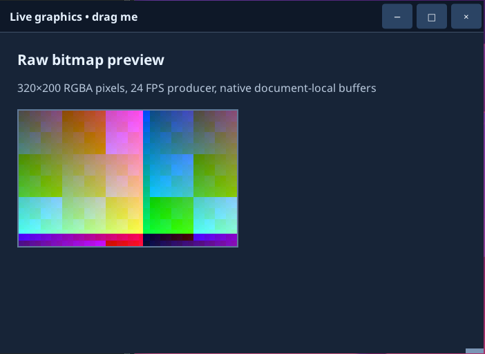

# Python patterns

Ready-to-adapt recipes for common desktop-app tasks. Each one is a complete program: save it as `app.py` and run `python app.py` (or `uv run app.py`). The HTML is inline to keep the examples short; in a real project put it in `index.html` and `style.css` and use `app.open_file(...)`.

A few rules apply to every recipe:

- Behavior lives in Python callbacks registered with `document.on(...)`. There is no JavaScript: HTML containing `<script>` or `onclick=`-style attributes is rejected when it loads.
- Code before `Application.start()` runs twice (once in the launcher, once in the backend), so keep work inside `main()` after `start()`.
- Callbacks run on a background thread of your program, one at a time, *after* the native action already happened.

The full list of calls is in the [Python API reference](../reference/python-api.md). For PowerShell, see the [PowerShell reference](../reference/powershell-api.md).

## Contents

1. [Respond to a button](#1-respond-to-a-button)
2. [Read a form](#2-read-a-form)
3. [Handle many items with one callback](#3-handle-many-items-with-one-callback)
4. [Update several elements at once](#4-update-several-elements-at-once)
5. [Switch screens by replacing the document](#5-switch-screens-by-replacing-the-document)
6. [Load HTML and CSS files](#6-load-html-and-css-files)
7. [Change styles at runtime](#7-change-styles-at-runtime)
8. [Follow the desktop's light/dark preference](#8-follow-the-desktops-lightdark-preference)
9. [Open and save files with native dialogs](#9-open-and-save-files-with-native-dialogs)
10. [Copy and paste](#10-copy-and-paste)
11. [Ask before closing](#11-ask-before-closing)
12. [Run slow work without freezing events](#12-run-slow-work-without-freezing-events)
13. [Stream pixels with a live bitmap](#13-stream-pixels-with-a-live-bitmap)
14. [Work with elements that have no id](#14-work-with-elements-that-have-no-id)
15. [Keyboard shortcuts](#15-keyboard-shortcuts)

## 1. Respond to a button

```python
from ui4me_core import Application

HTML = """
<button id="save">Save</button>
<p id="status" role="status">Not saved</p>
"""


def main():
    with Application.start(name="Button demo") as app:
        window = app.open_html(HTML, title="Button demo", width=400, height=200)
        document = window.document

        def handle_save(event):
            document.set_text("status", "Saved")

        document.on("click", handle_save, element="save")
        app.run()


if __name__ == "__main__":
    main()
```

`element="save"` is the button's `id`. `set_text` always inserts plain text, so it is safe for anything the user typed.

## 2. Read a form

Prevent the form's native submission in advance, then handle `submit` in Python. Registering `prevent_default` inside the callback would be too late, because events arrive after the native action.

```python
from ui4me_core import Application

HTML = """
<form id="signup">
  <label for="person">Name</label>
  <input id="person" name="person" type="text" required>
  <label><input id="news" name="news" type="checkbox"> Send me news</label>
  <button id="send" type="submit">Sign up</button>
</form>
<p id="result" role="status">Waiting</p>
"""


def main():
    with Application.start(name="Form demo") as app:
        window = app.open_html(HTML, title="Form demo", width=420, height=260)
        document = window.document
        document.prevent_default("signup", "submit")

        def handle_submit(event):
            name = document.get_value("person").strip()
            wants_news = document.get_checked("news")
            document.set_text("result", f"Welcome, {name}! News: {'yes' if wants_news else 'no'}")
            document.set_value("person", "")

        def show_typing(event):
            document.set_text("result", "Typing: " + event["value"])

        document.on("submit", handle_submit, element="signup")
        document.on("input", show_typing, element="person")
        app.run()


if __name__ == "__main__":
    main()
```

The `required` attribute is checked natively: an empty name does not submit. `document.form_data("signup")` returns every entry in order, if you prefer reading the form in one call. For live validation, `document.set_custom_validity("person", "That name is taken")` marks the field invalid and `""` clears it.

Text-control selection (`document.control_selection(...)`) uses **UTF-16 offsets**, not Python indices: an emoji counts as 2.

## 3. Handle many items with one callback

A callback registered with `element="todo-list"` also receives events from everything inside the list, because events bubble. `event["element"]` is the nearest element with an `id`.

```python
from html import escape

from ui4me_core import Application

HTML = """
<input id="new-task" type="text" placeholder="New task">
<button id="add">Add</button>
<ul id="todo-list"></ul>
"""


def main():
    with Application.start(name="Tasks") as app:
        window = app.open_html(HTML, title="Tasks", width=420, height=400)
        document = window.document
        counter = 0

        def add_task(event):
            nonlocal counter
            title = document.get_value("new-task").strip()
            if not title:
                return
            counter += 1
            # Escape user text before putting it into HTML.
            item = f'<li id="task-{counter}">{escape(title)}</li>'
            document.insert_html("todo-list", item)
            document.set_value("new-task", "")

        def remove_task(event):
            if event["element"].startswith("task-"):
                document.remove(event["element"])

        document.on("click", add_task, element="add")
        document.on("click", remove_task, element="todo-list")
        app.run()


if __name__ == "__main__":
    main()
```

Only `insert_html` and `replace_html` parse HTML. Treat their input as code: build it from your own templates and pass user text through `html.escape()`.

## 4. Update several elements at once

`document.batch(...)` applies a group of changes as one transaction: either all succeed or none do, and the window repaints once.

```python
from ui4me_core import Application

HTML = """
<h2 id="title">Order</h2>
<p id="total">0.00</p>
<p id="state" class="pending">Pending</p>
<ul id="log"></ul>
<button id="pay">Pay</button>
"""


def main():
    with Application.start(name="Batch demo") as app:
        window = app.open_html(HTML, title="Batch demo", width=400, height=320)
        document = window.document

        def pay(event):
            document.batch([
                {"op": "set_text", "element": "total", "text": "42.00"},
                {"op": "remove_class", "element": "state", "name": "pending"},
                {"op": "add_class", "element": "state", "name": "paid"},
                {"op": "set_text", "element": "state", "text": "Paid"},
                {"op": "append_text", "element": "title", "text": " (complete)"},
                {"op": "insert_html", "element": "log", "position": "beforeend", "html": "<li>Paid</li>"},
                {"op": "trim_children", "element": "log", "keep": 50, "from": "start"},
                {"op": "set_attribute", "element": "pay", "name": "disabled", "value": ""},
            ])

        document.on("click", pay, element="pay")
        app.run()


if __name__ == "__main__":
    main()
```

Batch operations: `set_text`, `append_text`, `set_attribute`, `remove_attribute`, `add_class`, `remove_class`, `insert_html`, `replace_children_html`, `remove_element`, `move_element` and `trim_children`, at most 1024 per batch. Form values (`set_value`, `set_checked`), focus and stylesheets are separate calls. `trim_children` keeps a growing log bounded: `"from": "start"` removes the oldest entries.

## 5. Switch screens by replacing the document

Loading new HTML into a window replaces the whole page and returns a new `Document`. The old document, its nodes and its callbacks are retired; using them raises `StaleDocumentError`. Register callbacks again on the new document.

```python
from ui4me_core import Application

LOGIN = """
<h1>Sign in</h1>
<input id="user" type="text" value="ada">
<button id="login">Continue</button>
"""

HOME = """
<h1 id="welcome">Home</h1>
<button id="logout">Sign out</button>
"""


def main():
    with Application.start(name="Screens") as app:
        window = app.open_html(LOGIN, title="Screens", width=420, height=240)

        def show_login():
            document = window.load_html(LOGIN)
            document.on("click", handle_login, element="login")

        def show_home(user):
            document = window.load_html(HOME)
            document.set_text("welcome", "Welcome, " + user)
            document.on("click", handle_logout, element="logout")

        def handle_login(event):
            user = window.document.get_value("user")
            show_home(user)

        def handle_logout(event):
            show_login()

        window.document.on("click", handle_login, element="login")
        app.run()


if __name__ == "__main__":
    main()
```

Read `window.document` when you need the current page, instead of keeping an old `Document` variable around. For small changes, prefer updating the existing page; reload only to switch whole screens. If a load fails (for example the HTML is over 1 MiB), the previous page stays.

## 6. Load HTML and CSS files

```text
my-app/
  app.py
  index.html
  style.css
  images/logo.png
```

```python
from pathlib import Path

from ui4me_core import Application

HERE = Path(__file__).resolve().parent


def main():
    with Application.start(name="Files demo") as app:
        window = app.open_file(HERE / "index.html", title="Files demo")
        app.run()


if __name__ == "__main__":
    main()
```

```html
<!doctype html>
<html lang="en">
<head>
  <meta charset="utf-8">
  <link rel="stylesheet" href="style.css">
</head>
<body>
  
  <h1>My desktop app</h1>
</body>
</html>
```

Relative URLs resolve from the HTML file's folder and must stay inside it. Use local files only; network URLs are not loaded. Bundling fonts with `@font-face` makes typography identical on every machine. For HTML built in Python, pass the folder explicitly: `app.open_html(html, asset_root=HERE)`. `ui4me-new my-app` creates this layout for you.

## 7. Change styles at runtime

Toggle classes for state, and add a stylesheet for values computed in Python.

```python
from ui4me_core import Application

HTML = """
<style>
  .card { padding: 16px; border-radius: 8px; background: #f2f4f7; color: #1d2633; }
  .card.highlight { outline: 3px solid #2f80ed; }
</style>
<div id="card" class="card">A card</div>
<button id="toggle">Highlight</button>
<button id="warm">Warm background</button>
"""


def main():
    with Application.start(name="Styles") as app:
        window = app.open_html(HTML, title="Styles", width=420, height=240)
        document = window.document
        added = document.add_stylesheet(".card { font-size: 18px; }")
        sheet = added["sheet"]
        highlighted = False

        def toggle(event):
            nonlocal highlighted
            highlighted = not highlighted
            if highlighted:
                document.add_class("card", "highlight")
            else:
                document.remove_class("card", "highlight")

        def make_warm(event):
            document.replace_stylesheet(sheet, ".card { font-size: 18px; background: #ffe8cc; }")

        document.on("click", toggle, element="toggle")
        document.on("click", make_warm, element="warm")
        app.run()


if __name__ == "__main__":
    main()
```

If a property seems ignored, check `document.computed_style(["outline-color"], "card")` (each property reports `supported`, `unsupported` or `invalid`) and `document.diagnostics()`. See [HTML/CSS scope](../concepts/html-css-scope.md).

## 8. Follow the desktop's light/dark preference

The engine's `prefers-color-scheme` media query follows the desktop setting automatically, so CSS alone usually suffices:

```css
:root { color-scheme: light dark; --bg: #ffffff; --text: #1d2633; }
@media (prefers-color-scheme: dark) {
  :root { --bg: #0d1727; --text: #ecf4ff; }
}
body { background: var(--bg); color: var(--text); }
```

To offer an in-app choice, override it per document from Python:

```python
from ui4me_core import Application

HTML = """
<style>
  body { background: #ffffff; color: #1d2633; }
  @media (prefers-color-scheme: dark) { body { background: #0d1727; color: #ecf4ff; } }
</style>
<select id="theme">
  <option value="system">System</option>
  <option value="light">Light</option>
  <option value="dark">Dark</option>
</select>
<p id="desktop">Desktop preference: unknown</p>
"""


def main():
    with Application.start(name="Theme") as app:
        window = app.open_html(HTML, title="Theme", width=400, height=200)
        document = window.document

        def choose_theme(event):
            document.set_environment(color_scheme=event["value"])

        def show_preferences(snapshot):
            scheme = snapshot.get("color_scheme") or "unknown"
            document.set_text("desktop", "Desktop preference: " + scheme)

        document.on("change", choose_theme, element="theme")
        app.on_desktop_preferences(show_preferences)
        show_preferences(app.desktop_preferences())
        app.run()


if __name__ == "__main__":
    main()
```

Desktop values can be `None` when the platform does not report them (for example in a minimal Linux session); design for that case.

## 9. Open and save files with native dialogs

File pickers are native operating-system dialogs owned by the window. With the default `wait=True` the call blocks until the user decides and returns `{"cancelled": ..., "paths": [...]}`. Blocking inside an event callback is fine: close and quit still work while a dialog is open.

```python
from pathlib import Path

from ui4me_core import Application

HTML = """
<button id="open">Open…</button>
<button id="save">Save as…</button>
<textarea id="editor" rows="10" cols="60"></textarea>
<p id="status" role="status">No file</p>
"""
TEXT_FILES = [{"name": "Text files", "extensions": ["txt", "md"]}]


def main():
    with Application.start(name="Editor") as app:
        window = app.open_html(HTML, title="Editor", width=640, height=420)
        document = window.document

        def open_file(event):
            result = window.open_files(title="Open a text file", filters=TEXT_FILES)
            if result["cancelled"] or not result["paths"]:
                return
            path = Path(result["paths"][0])
            document.set_value("editor", path.read_text(encoding="utf-8"))
            document.set_text("status", "Opened " + path.name)

        def save_file(event):
            result = window.save_file(file_name="notes.txt", filters=TEXT_FILES)
            if result["cancelled"] or not result["paths"]:
                return
            path = Path(result["paths"][0])
            path.write_text(document.get_value("editor"), encoding="utf-8")
            document.set_text("status", "Saved " + path.name)

        document.on("click", open_file, element="open")
        document.on("click", save_file, element="save")
        app.run()


if __name__ == "__main__":
    main()
```

Other options: `window.open_files(multiple=True)`, `window.choose_folder()`, and `directory=` for the starting folder. With `wait=False` you get a `concurrent.futures.Future`; `future.cancel()` closes the dialog. An `<input type="file">` in the page also opens the native picker; read its paths with `document.files("input-id")`. On Linux the dialog comes from the desktop portal, which decides its own appearance.

## 10. Copy and paste

```python
from ui4me_core import Application

HTML = """
<input id="field" type="text" value="Copy me">
<button id="copy">Copy</button>
<button id="paste">Paste</button>
<p id="status" role="status"></p>
"""


def main():
    with Application.start(name="Clipboard") as app:
        window = app.open_html(HTML, title="Clipboard", width=420, height=200)
        document = window.document

        def copy_value(event):
            app.set_clipboard_text(document.get_value("field"))
            document.set_text("status", "Copied")

        def paste_value(event):
            document.set_value("field", app.clipboard_text())
            document.set_text("status", "Pasted")

        def show_error(event):
            document.set_text("status", "Error: " + event["message"])

        document.on("click", copy_value, element="copy")
        document.on("click", paste_value, element="paste")
        document.on("error", show_error)
        app.run()


if __name__ == "__main__":
    main()
```

Ctrl+C/Ctrl+V inside text fields already work natively. `document.edit("copy", "field")` runs the same native editing command from Python; it completes asynchronously, and a failure arrives as an `error` event.

## 11. Ask before closing

A before-close callback returns `True` to let the window close or `False` to keep it open. Closing the last window asks to quit the application, which runs the before-quit callback.

```python
import threading

from ui4me_core import Application

HTML = """
<textarea id="notes" rows="6" cols="40"></textarea>
<p id="status" role="status">Saved</p>
<button id="save">Save</button>
<button id="quit">Quit</button>
"""


def main():
    with Application.start(name="Unsaved changes") as app:
        window = app.open_html(HTML, title="Unsaved changes", width=440, height=300)
        document = window.document
        lock = threading.Lock()
        state = {"dirty": False}

        def mark_dirty(event):
            with lock:
                state["dirty"] = True
            document.set_text("status", "Unsaved changes")

        def save(event):
            with lock:
                state["dirty"] = False
            document.set_text("status", "Saved")

        def quit_app(event):
            app.request_quit()

        def allow_close():
            with lock:
                dirty = state["dirty"]
            if dirty:
                document.set_text("status", "Save first, or your changes will be lost")
            return not dirty

        document.on("input", mark_dirty, element="notes")
        document.on("click", save, element="save")
        document.on("click", quit_app, element="quit")
        window.on_before_close(allow_close)
        app.on_before_quit(allow_close)
        app.run()


if __name__ == "__main__":
    main()
```

Policy callbacks run on a different thread from event callbacks, possibly at the same time, hence the lock. Answer quickly; do not open dialogs or do slow work inside them. An exception in a policy callback counts as "no".

## 12. Run slow work without freezing events

Event callbacks run one at a time. A callback that takes ten seconds delays every later event. Start a thread and send small updates from it; document methods are safe to call from any thread.

```python
import threading
import time

from ui4me_core import Application, StaleDocumentError

HTML = """
<button id="start">Start</button>
<progress id="bar" max="100" value="0"></progress>
<p id="status" role="status">Idle</p>
"""


def main():
    with Application.start(name="Worker") as app:
        window = app.open_html(HTML, title="Worker", width=400, height=200)
        document = window.document

        def work():
            try:
                for step in range(1, 101):
                    time.sleep(0.05)  # stand-in for real work
                    document.set_attribute("bar", "value", str(step))
                document.set_text("status", "Done")
            except StaleDocumentError:
                pass  # The window closed or the page changed; stop quietly.

        def start(event):
            document.set_text("status", "Working…")
            threading.Thread(target=work, daemon=True).start()

        document.on("click", start, element="start")
        app.run()


if __name__ == "__main__":
    main()
```

## 13. Stream pixels with a live bitmap

For pictures that change many times per second, write raw RGBA pixels into a live bitmap. The pixels travel through shared memory, not JSON, and same-sized frames do not re-run layout.



```python
import threading

from ui4me_core import Application

WIDTH, HEIGHT = 256, 160
HTML = f"""

"""


def main():
    with Application.start(name="Live bitmap") as app:
        window = app.open_html(HTML, title="Live bitmap", width=320, height=240)
        document = window.document
        bitmap = document.create_bitmap("preview", WIDTH, HEIGHT)
        stop = threading.Event()

        def produce():
            frame = bytearray(WIDTH * HEIGHT * 4)
            tick = 0
            while not stop.wait(1 / 30):
                tick = (tick + 4) % 256
                for y in range(HEIGHT):
                    row = bytes([tick, y, 255 - tick, 255]) * WIDTH
                    frame[y * WIDTH * 4:(y + 1) * WIDTH * 4] = row
                try:
                    bitmap.try_present(frame)  # None means "busy, frame skipped"
                except Exception:
                    break  # The document or window went away.

        producer = threading.Thread(target=produce, daemon=True)
        producer.start()
        try:
            app.run()
        finally:
            stop.set()
            producer.join(timeout=2)
            bitmap.close()


if __name__ == "__main__":
    main()
```

A frame is exactly `width * height * 4` bytes of straight-alpha RGBA, row by row. `present` waits until the host has taken the frame; `try_present` skips a frame instead of waiting. A bitmap belongs to its document and is closed automatically if the page is replaced. Limits: 4096 pixels per side, 8 bitmaps and 64 MiB per document.

## 14. Work with elements that have no id

`query_nodes` finds elements by CSS selector, including ones without an `id`, and returns opaque references. Wrap them with `document.node(reference=...)`.

```python
from ui4me_core import Application

HTML = """
<ul id="list">
  <li>Apples</li>
  <li>Pears</li>
  <li>Plums</li>
</ul>
<button id="mark">Mark every other item</button>
<button id="first">Move last item first</button>
"""


def main():
    with Application.start(name="Nodes") as app:
        window = app.open_html(HTML, title="Nodes", width=400, height=260)
        document = window.document

        def mark(event):
            result = document.query_nodes("#list > li:nth-child(odd)")
            operations = []
            for entry in result["nodes"]:
                operations.append({"op": "add_class", "node": entry["node"], "name": "marked"})
            document.node_batch(operations)

        def move_last_first(event):
            items = document.query_nodes("#list > li")["nodes"]
            if len(items) < 2:
                return
            last = document.node(reference=items[-1]["node"])
            first = document.node(reference=items[0]["node"])
            last.move_to(first, position="beforebegin")

        document.on("click", mark, element="mark")
        document.on("click", move_last_first, element="first")
        app.run()


if __name__ == "__main__":
    main()
```

Node references belong to one document generation; after a reload, look them up again. `node_batch` takes the same operations as `batch`, with `node` instead of `element` (and `target_node` instead of `target` for moves). For a fixed set of elements you control, giving them `id`s and using `batch` is simpler.

## 15. Keyboard shortcuts

```python
from ui4me_core import Application

HTML = """
<textarea id="editor" rows="8" cols="50"></textarea>
<p id="status" role="status">Press Ctrl+S to save</p>
"""


def main():
    with Application.start(name="Shortcuts") as app:
        window = app.open_html(HTML, title="Shortcuts", width=480, height=300)
        document = window.document
        # Stop Ctrl+S from typing into the text area; register before input.
        document.prevent_default("editor", "keydown", key="s", ctrl=True)

        def handle_key(event):
            if event.get("ctrl") and event.get("key", "").lower() == "s":
                document.set_text("status", "Saved")

        document.on("keydown", handle_key, element="editor")
        document.focus("editor")
        app.run()


if __name__ == "__main__":
    main()
```

## Testing a recipe without a desktop

`UI4ME_TEST_MODE=1` runs the host headless: the document engine and lifecycle work, no window is shown, and the program must end itself. Add a timer before `app.run()` for a smoke test:

```python
import threading

from ui4me_core import Application


def main():
    with Application.start(name="Smoke test") as app:
        window = app.open_html('<p id="msg">Hello</p>')
        assert window.document.get_text("msg") == "Hello"
        threading.Timer(0.5, app.request_quit).start()
        app.run()


if __name__ == "__main__":
    main()
```

```sh
UI4ME_TEST_MODE=1 python smoke.py
```

Headless mode cannot check real input, IME, clipboard, native dialogs or how the window looks; try those on a real desktop. See [platforms](platforms.md) and [troubleshooting](troubleshooting.md).
