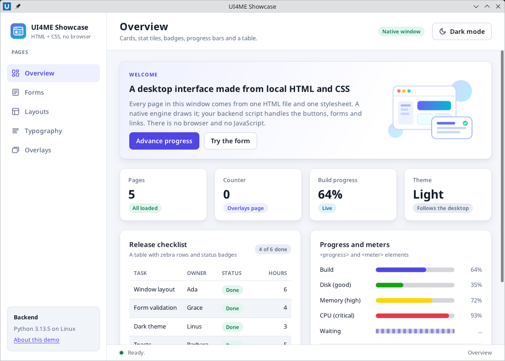
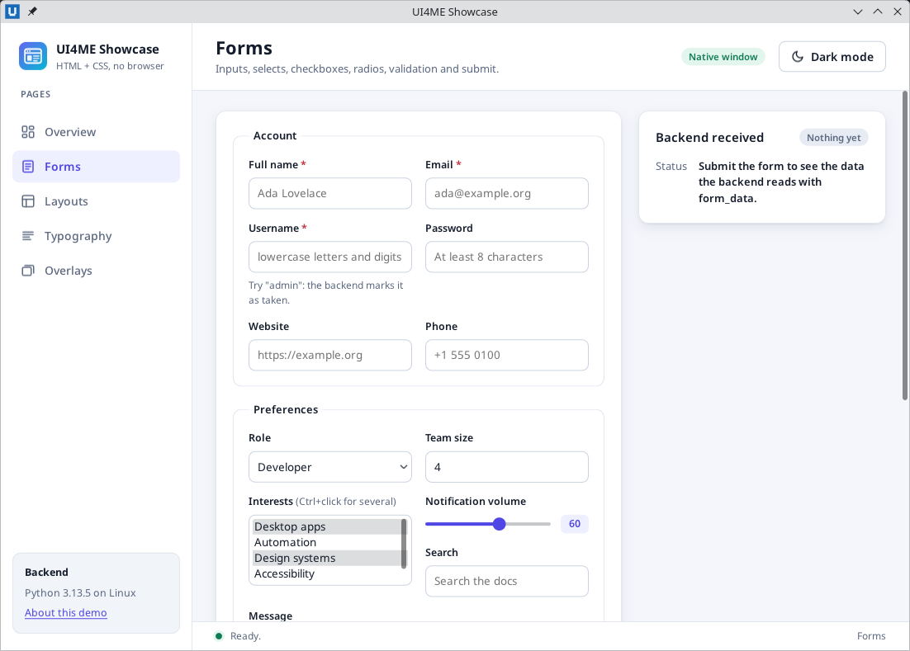
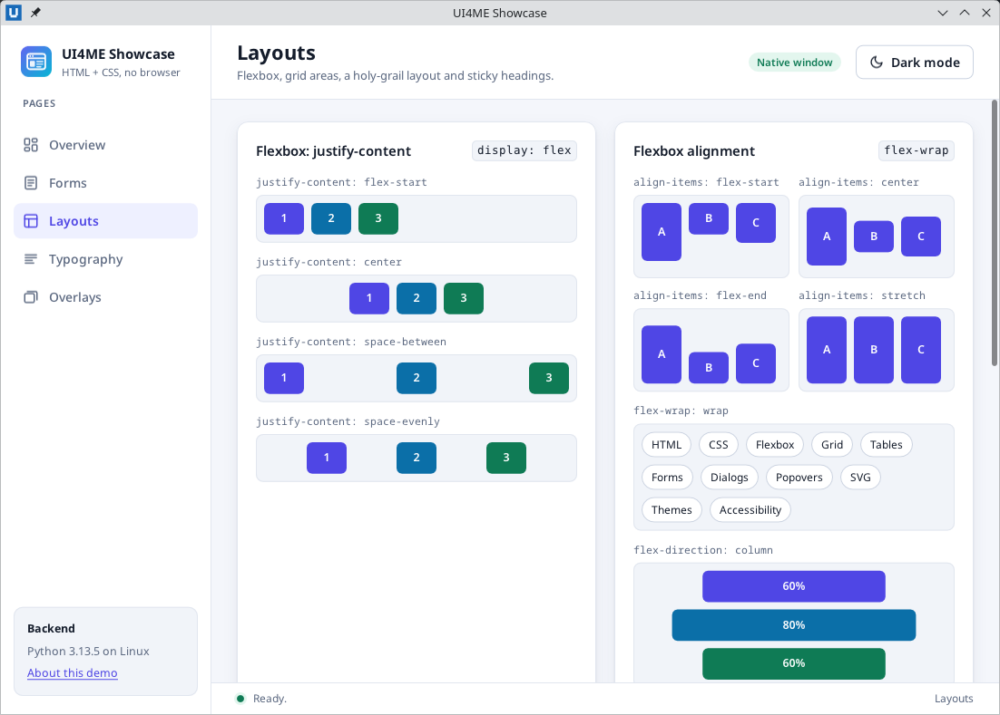
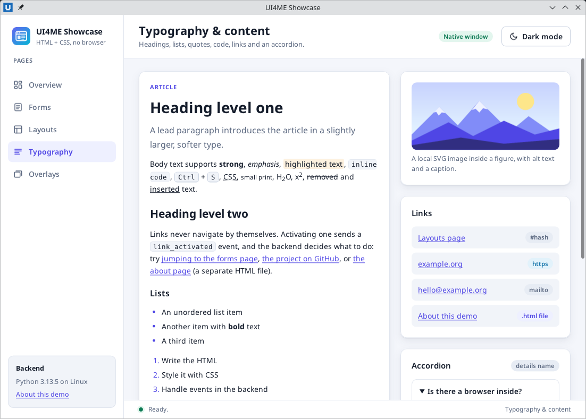
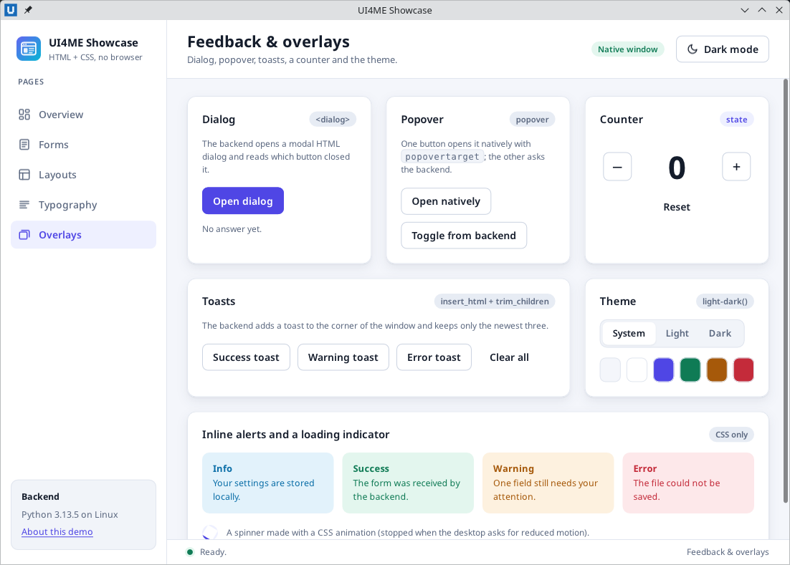

# Showcase app

The showcase is a small multi-page desktop app that does nothing real. It exists to show, in one window, the HTML elements, CSS layouts and interaction patterns that UI4ME Core supports, so you can see them working and copy what you need. It comes twice, with identical behaviour:

| Version | Backend | Interface |
| --- | --- | --- |
| Python | [`examples/python/showcase/app.py`](../../examples/python/showcase/app.py) | [`examples/python/showcase/ui/`](../../examples/python/showcase/ui/index.html) |
| PowerShell | [`powershell/examples/showcase/app.ps1`](../../powershell/examples/showcase/app.ps1) | [`powershell/examples/showcase/ui/`](../../powershell/examples/showcase/ui/index.html) |

Each folder is self-contained: its own `index.html`, `about.html`, `style.css` and SVG images. The two interfaces are the same apart from one code sample on the typography page. The interface is plain local HTML and CSS drawn by the native UI4ME engine; there is no browser and no JavaScript. Everything that reacts to the user (switching pages, the theme toggle, the form, the dialog, the toasts, links) is ordinary Python or PowerShell code in the backend.

## Contents

- [What it shows](#what-it-shows)
- [Run it](#run-it)
- [Screenshots](#screenshots)
- [Walkthrough](#walkthrough)
- [Project structure](#project-structure)

## What it shows

| Page | Components and patterns |
| --- | --- |
| **Overview** | App shell (sidebar, top bar, scrolling content, status bar), cards in a CSS grid, stat tiles, badges, `<progress>` (determinate and indeterminate), `<meter>` with low/high/optimum colours, a table with zebra rows, an SVG illustration, a button that updates the progress bar from the backend |
| **Forms** | `fieldset`/`legend`, labels, `text`, `email`, `password`, `url`, `tel`, `number`, `search` and `range` inputs with a live `<output>`, `textarea`, `select` with `optgroup`, a multiple `select`, radio cards, checkboxes, primary/secondary/disabled buttons, `required`/`minlength`/`pattern` validation, a custom validity message set by the backend, `invalid` events, submit and reset handled by the backend |
| **Layouts** | Flexbox `justify-content`, `align-items`, `flex-wrap` and `flex-direction: column`; grid with named areas and spans; a holy-grail layout; an `auto-fill` grid; multi-column text; a scroll container with `position: sticky` headings |
| **Typography & content** | Headings, lead paragraph, inline semantics (`strong`, `em`, `mark`, `code`, `kbd`, `abbr`, `sub`, `sup`, `del`, `ins`), `ul`, `ol`, `dl`, `blockquote`, `pre`, a `figure` with an image and `alt` text, links handled by the backend, a `details`/`summary` accordion (exclusive through `name`) |
| **Feedback & overlays** | A modal `<dialog>` opened and closed by the backend, a `popover` opened natively (`popovertarget`) and from the backend, toasts added and trimmed by the backend, a counter, a System/Light/Dark theme switch, inline alerts and a CSS animation |

The **About this demo** link loads a second HTML file, `about.html`, into the same window. Its link back loads `index.html` again and restores the page, theme and counter. So the app demonstrates both ways of having several screens: one document whose sections the backend shows and hides, and separate HTML files loaded with `window.load_file()` / `Open-UI4MEFile`.

The light and dark themes follow the desktop's preference automatically; the theme toggle overrides it for the window.

## Run it

From a clone of the repository, with the package or module installed ([Python](install-python.md), [PowerShell](install-powershell.md)):

```sh
python examples/python/showcase/app.py
```

```sh
pwsh -File powershell/examples/showcase/app.ps1
```

On Windows PowerShell 5.1:

```powershell
powershell.exe -NoProfile -File .\powershell\examples\showcase\app.ps1
```

Both are ordinary scripts: the first run starts the native host, which runs the script a second time as the connected backend. The PowerShell script imports the installed `UI4ME.Core` module and falls back to the module in the checkout if it is not installed. To run against a host you built yourself, set `UI4ME_HOST_BINARY` (and `PYTHONPATH=python` for Python) as described in [development](development.md).

## Screenshots











## Walkthrough

Each section shows the important part of the interface and the backend code that goes with it, first in Python, then the same behaviour in PowerShell. In Python, the handlers are methods of a small `Showcase` class that holds the state (`self.document`, `self.page`, `self.counter`, ...). In PowerShell, they are scriptblocks stored in variables such as `$onNavigate`, and the state lives in `$script:` variables. The complete files are linked [above](#showcase-app).

### Registering handlers

All handlers are registered right after the document loads. Because loading a new document retires the old one and its subscriptions, the same function runs again when the app comes back from `about.html`.

```python
def open_main(self):
    self.document = self.window.load_file(UI / "index.html")
    d = self.document
    d.prevent_default("signup", "submit")
    d.on("click", self.on_navigate, element="nav")
    d.on("click", self.on_theme_toggle, element="theme-toggle")
    d.on("link_activated", self.on_link)
    d.on("submit", self.on_submit, element="signup")
    d.on("invalid", self.on_invalid)
    # ... one line per handler ...
    self.apply_theme()
    self.show_page(self.page)
```

```powershell
function Open-Main {
    $script:doc = Open-UI4MEFile -Window $window -Path (Join-Path $UiFolder 'index.html')
    $d = $script:doc
    Set-UI4MEPreventDefault -Document $d -Element signup -EventType submit
    $null = Register-UI4MEDocumentEvent -Document $d -Type click -Element nav -Callback $onNavigate
    $null = Register-UI4MEDocumentEvent -Document $d -Type click -Element theme-toggle -Callback $onThemeToggle
    $null = Register-UI4MEDocumentEvent -Document $d -Type link_activated -Callback $onLink
    $null = Register-UI4MEDocumentEvent -Document $d -Type submit -Element signup -Callback $onSubmit
    $null = Register-UI4MEDocumentEvent -Document $d -Type invalid -Callback $onInvalid
    # ... one line per handler ...
    Update-Theme
    Show-Page $script:page
}
```

With `element=` / `-Element`, a handler also receives events from everything inside that element. The event's `element` field is the `id` of the element that was actually clicked, so one handler serves the whole sidebar.

### Navigation (all pages)

Every page is a `<section class="page">` inside the scrolling `#pages` container; only the one with class `active` is displayed. Each sidebar button has the id `nav-` plus the page name.

```html
<nav id="nav" class="nav" aria-label="Pages">
  <button id="nav-overview" class="nav-item active" type="button" aria-current="page">Overview</button>
  <button id="nav-forms" class="nav-item" type="button" aria-current="false">Forms</button>
  <!-- ... -->
</nav>
<div id="pages" class="pages">
  <section id="page-overview" class="page active">...</section>
  <section id="page-forms" class="page">...</section>
  <!-- ... -->
</div>
```

```css
.page { display: flex; flex-direction: column; gap: 20px; }
.page:not(.active) { display: none; }
.nav-item.active { background: var(--accent-soft); color: var(--accent); font-weight: 600; }
```

The backend moves the `active` class with one atomic batch, so the window never shows two pages or none:

```python
def on_navigate(self, event):
    if event["element"].startswith("nav-"):
        self.show_page(event["element"].removeprefix("nav-"))
        self.set_status(f"Showing the {PAGES[self.page][0]} page.")

def show_page(self, name):
    if name not in PAGES:
        return
    self.page = name
    title, subtitle = PAGES[name]
    operations = []
    for page in PAGES:
        change = "add_class" if page == name else "remove_class"
        current = "page" if page == name else "false"
        operations += [
            {"op": change, "element": f"page-{page}", "name": "active"},
            {"op": change, "element": f"nav-{page}", "name": "active"},
            {"op": "set_attribute", "element": f"nav-{page}", "name": "aria-current", "value": current},
        ]
    operations += [
        {"op": "set_text", "element": "page-title", "text": title},
        {"op": "set_text", "element": "page-subtitle", "text": subtitle},
        {"op": "set_text", "element": "status-page", "text": title},
    ]
    self.document.batch(operations)
    self.document.scroll_to(element="pages", y=0)
```

```powershell
$onNavigate = {
    param($e)
    if ($e.element.StartsWith('nav-')) {
        Show-Page $e.element.Substring(4)
        Set-Status "Showing the $($Pages[$script:page][0]) page."
    }
}

function Show-Page([string]$Name) {
    if (-not $Pages.Contains($Name)) { return }
    $script:page = $Name
    $ops = @()
    foreach ($p in $Pages.Keys) {
        $change = if ($p -eq $Name) { 'add_class' } else { 'remove_class' }
        $current = if ($p -eq $Name) { 'page' } else { 'false' }
        $ops += @{ op = $change; element = "page-$p"; name = 'active' }
        $ops += @{ op = $change; element = "nav-$p"; name = 'active' }
        $ops += @{ op = 'set_attribute'; element = "nav-$p"; name = 'aria-current'; value = $current }
    }
    $ops += @{ op = 'set_text'; element = 'page-title'; text = $Pages[$Name][0] }
    $ops += @{ op = 'set_text'; element = 'page-subtitle'; text = $Pages[$Name][1] }
    $ops += @{ op = 'set_text'; element = 'status-page'; text = $Pages[$Name][0] }
    Invoke-UI4MEBatch -Document $script:doc -Operations $ops
    $null = Set-UI4MEScroll -Document $script:doc -Element pages -Y 0
}
```

`PAGES` / `$Pages` maps each page name to its title and subtitle. To add a page, add a `<section id="page-NAME" class="page">`, a `<button id="nav-NAME">` in the sidebar and an entry in that table.

### Overview: cards, progress and stat tiles

The cards are a CSS grid; the stat tiles and the progress bar have ids so the backend can update them.

```html
<div class="stats">
  <article class="card stat"><span class="stat-label">Counter</span><strong id="stat-counter" class="stat-value">0</strong><span class="badge accent">Overlays page</span></article>
  <article class="card stat"><span class="stat-label">Build progress</span><strong id="stat-progress" class="stat-value">64%</strong><span class="badge info">Live</span></article>
  <!-- ... -->
</div>
<progress id="build-progress" max="100" value="64">64%</progress>
<meter min="0" max="100" low="60" high="85" optimum="20" value="72">72%</meter>
<button id="advance" class="btn primary" type="button">Advance progress</button>
```

```css
.stats { display: grid; grid-template-columns: repeat(4, minmax(0, 1fr)); gap: 16px; }
.table.zebra tbody tr:nth-child(even) td { background: var(--surface-2); }
progress, meter { width: 100%; height: 10px; accent-color: var(--accent); }
```

```python
def on_advance(self, event):
    self.progress = 0 if self.progress >= 100 else min(100, self.progress + 12)
    self.show_progress()
    self.set_status(f"Build progress: {self.progress}%.")

def show_progress(self):
    self.document.set_attribute("build-progress", "value", str(self.progress))
    self.document.set_text("progress-label", f"{self.progress}%")
    self.document.set_text("stat-progress", f"{self.progress}%")
```

```powershell
$onAdvance = {
    param($e)
    $script:progress = if ($script:progress -ge 100) { 0 } else { [Math]::Min(100, $script:progress + 12) }
    Show-Progress
    Set-Status "Build progress: $($script:progress)%."
}

function Show-Progress {
    $d = $script:doc
    Set-UI4MEDocumentAttribute -Document $d -Element build-progress -Name value -Value "$($script:progress)"
    Set-UI4MEDocumentText -Document $d -Element progress-label -Text "$($script:progress)%"
    Set-UI4MEDocumentText -Document $d -Element stat-progress -Text "$($script:progress)%"
}
```

### Forms: validation, custom validity and submit

The form uses native constraint validation (`required`, `minlength`, `pattern`, `type="email"`). The backend prevents the native submission in advance, adds its own rule (some usernames are "taken") and reads the data when a valid form is submitted.

```html
<form id="signup" class="card form">
  <fieldset>
    <legend>Account</legend>
    <label class="field"><span>Username <span class="req">*</span></span>
      <input id="username" name="username" type="text" required pattern="[a-z0-9_]{3,16}">
      <span id="username-hint" class="hint">Try "admin": the backend marks it as taken.</span></label>
    <!-- more fields, a select, radios, checkboxes ... -->
  </fieldset>
  <p id="form-feedback" class="feedback" role="status">...</p>
  <button id="reset-button" class="btn" type="reset">Reset</button>
  <button id="submit-button" class="btn primary" type="submit">Submit</button>
</form>
<dl id="form-result" class="result-list">...</dl>
```

```css
/* Invalid fields are only highlighted after the first submit attempt. */
.show-errors :is(input, select, textarea):invalid { border-color: var(--danger); box-shadow: 0 0 0 3px var(--danger-soft); }
.choice:has(input:checked) { border-color: var(--accent); background: var(--accent-soft); }
```

Live check while typing, with a custom validity message:

```python
def on_form_input(self, event):
    d = self.document
    self.invalid_fields.clear()
    if event["element"] == "volume":
        d.set_text("volume-out", event.get("value", ""))
    elif event["element"] == "username":
        if event.get("value", "").lower() in TAKEN_USERNAMES:
            d.set_custom_validity("username", "That username is already taken.")
            d.set_text("username-hint", "That username is already taken.")
            d.add_class("username-hint", "error")
        else:
            d.set_custom_validity("username", "")
            d.set_text("username-hint", 'Try "admin": the backend marks it as taken.')
            d.remove_class("username-hint", "error")
```

```powershell
$onFormInput = {
    param($e)
    $d = $script:doc
    $script:invalidFields.Clear()
    $value = [string]$e.value
    if ($e.element -eq 'volume') {
        Set-UI4MEDocumentText -Document $d -Element volume-out -Text $value
    } elseif ($e.element -eq 'username') {
        if ($TakenUsernames -contains $value.ToLowerInvariant()) {
            $null = Invoke-UI4MEDocumentCommand -Document $d -Operation set_custom_validity -Parameters @{ element = 'username'; message = 'That username is already taken.' }
            Set-UI4MEDocumentText -Document $d -Element username-hint -Text 'That username is already taken.'
            Set-UI4MEClass -Document $d -Element username-hint -Name error
        } else {
            $null = Invoke-UI4MEDocumentCommand -Document $d -Operation set_custom_validity -Parameters @{ element = 'username'; message = '' }
            Set-UI4MEDocumentText -Document $d -Element username-hint -Text 'Try "admin": the backend marks it as taken.'
            Set-UI4MEClass -Document $d -Element username-hint -Name error -Remove
        }
    }
}
```

A failed submit attempt sends one `invalid` event per invalid control (it does not bubble, so the handler is registered without an element filter). A valid one sends `submit`:

```python
def on_invalid(self, event):
    label = FIELD_LABELS.get(event["element"], event["element"])
    if label not in self.invalid_fields:
        self.invalid_fields.append(label)
    d = self.document
    d.add_class("signup", "show-errors")
    d.set_attribute("form-feedback", "class", "feedback error")
    d.set_text("form-feedback", "Please check: " + ", ".join(self.invalid_fields) + ".")

def on_submit(self, event):
    d = self.document
    self.invalid_fields.clear()
    values = {}
    for entry in d.form_data("signup")["entries"]:
        value = "*" * len(entry["value"]) if entry["name"] == "password" else entry["value"]
        values.setdefault(entry["name"], []).append(value)
    rows = "".join(
        f"<dt>{escape(name)}</dt><dd>{escape(', '.join(items) or '-')}</dd>"
        for name, items in values.items())
    d.replace_html("form-result", rows)
    d.set_text("result-badge", f"{len(values)} fields")
    d.set_attribute("result-badge", "class", "badge success")
    d.remove_class("signup", "show-errors")
    d.set_attribute("form-feedback", "class", "feedback success")
    d.set_text("form-feedback", "Submitted. The backend read the form with form_data().")
    self.set_status("Form submitted.")
```

```powershell
$onInvalid = {
    param($e)
    $label = $FieldLabels[[string]$e.element]
    if (-not $label) { $label = [string]$e.element }
    if (-not $script:invalidFields.Contains($label)) { [void]$script:invalidFields.Add($label) }
    $d = $script:doc
    Set-UI4MEClass -Document $d -Element signup -Name show-errors
    Set-UI4MEDocumentAttribute -Document $d -Element form-feedback -Name class -Value 'feedback error'
    Set-UI4MEDocumentText -Document $d -Element form-feedback -Text ('Please check: ' + ($script:invalidFields -join ', ') + '.')
}

$onSubmit = {
    param($e)
    $d = $script:doc
    $script:invalidFields.Clear()
    $values = [ordered]@{}
    foreach ($entry in (Get-UI4MEFormData -Document $d -Form signup).entries) {
        $value = [string]$entry.value
        if ($entry.name -eq 'password') { $value = '*' * $value.Length }
        if (-not $values.Contains($entry.name)) { $values[$entry.name] = New-Object System.Collections.ArrayList }
        [void]$values[$entry.name].Add($value)
    }
    $rows = foreach ($name in $values.Keys) {
        $joined = $values[$name] -join ', '
        if (-not $joined) { $joined = '-' }
        '<dt>' + [Net.WebUtility]::HtmlEncode($name) + '</dt><dd>' + [Net.WebUtility]::HtmlEncode($joined) + '</dd>'
    }
    Set-UI4MEDocumentHtml -Document $d -Element form-result -Html (@($rows) -join '')
    Set-UI4MEDocumentText -Document $d -Element result-badge -Text "$($values.Count) fields"
    Set-UI4MEDocumentAttribute -Document $d -Element result-badge -Name class -Value 'badge success'
    Set-UI4MEClass -Document $d -Element signup -Name show-errors -Remove
    Set-UI4MEDocumentAttribute -Document $d -Element form-feedback -Name class -Value 'feedback success'
    Set-UI4MEDocumentText -Document $d -Element form-feedback -Text 'Submitted. The backend read the form with Get-UI4MEFormData.'
    Set-Status 'Form submitted.'
}
```

Form entries keep document order, and repeated names (the `notify` checkboxes, the multiple `select`) appear once per selected value. User input is escaped before it goes into HTML. The full files also handle `reset` (the native reset has already restored the defaults when the event arrives).

### Layouts: pure CSS

The layouts page has no backend code of its own; it is there to copy CSS from. The two most useful patterns:

```html
<div class="grid-areas">
  <div class="ga-a">a: spans two columns</div>
  <div class="ga-b">b: spans two rows</div>
  <div class="ga-c">c</div><div class="ga-d">d</div>
  <div class="ga-e">e: full width</div>
</div>
<div id="contacts" class="scroll-box">
  <h4>A</h4>
  <ul><li>Ada Lovelace <span>Analyst</span></li><li>Alan Turing <span>Mathematician</span></li></ul>
  <!-- ... -->
</div>
```

```css
.grid-areas {
  display: grid; gap: 8px; height: 220px;
  grid-template-columns: 1fr 1fr 1fr;
  grid-template-rows: 1fr 1fr auto;
  grid-template-areas: "a a b" "c d b" "e e e";
}
.ga-a { grid-area: a; } .ga-b { grid-area: b; } .ga-c { grid-area: c; } .ga-d { grid-area: d; } .ga-e { grid-area: e; }

.scroll-box { height: 220px; overflow: auto; }
.scroll-box h4 { position: sticky; top: 0; background: var(--surface-2); }
```

The only backend involvement is that `show_page` / `Show-Page` scrolls the page container back to the top when you switch pages:

```python
self.document.scroll_to(element="pages", y=0)
```

```powershell
$null = Set-UI4MEScroll -Document $script:doc -Element pages -Y 0
```

The whole app shell is also a layout: a two-column grid (sidebar and main column), and a main column with three rows (top bar, scrolling content, status bar). A `@media (max-width: ...)` block collapses the grids and the sidebar labels in narrow windows.

```css
.shell { display: grid; grid-template-columns: 232px minmax(0, 1fr); height: 100vh; }
.main { display: grid; grid-template-rows: auto minmax(0, 1fr) auto; min-width: 0; height: 100vh; }
.pages { overflow: auto; padding: 24px 28px 32px; }
```

### Typography and content: links

Links never navigate on their own. Each activation sends a `link_activated` event with the `href` as written and the resolved `url`; the backend decides what happens.

```html
<a id="link-forms" href="#forms">jumping to the forms page</a>
<a id="link-docs" href="https://github.com/ui4me/ui4me-core">the project on GitHub</a>
<a id="link-about" href="about.html">the about page</a>
```

```python
def on_link(self, event):
    href = event.get("href", "")
    if href.startswith("#"):
        self.show_page(href[1:])
        self.set_status(f"Link to {href} handled by the backend.")
    elif href == "about.html":
        self.open_about()
    elif href == "index.html":
        self.open_main()
        self.set_status("Back from about.html: the page, theme and counter were restored.")
    else:
        # A real application could call self.app.open_external(event["url"]).
        self.set_status(f"Link activated: {event['url']} (not opened in this demo).")

def open_about(self):
    self.document = self.window.load_file(UI / "about.html")
    self.document.on("link_activated", self.on_link)
    self.apply_theme()
```

```powershell
$onLink = {
    param($e)
    $href = [string]$e.href
    if ($href.StartsWith('#')) {
        Show-Page $href.Substring(1)
        Set-Status "Link to $href handled by the backend."
    } elseif ($href -eq 'about.html') {
        Open-About
    } elseif ($href -eq 'index.html') {
        Open-Main
        Set-Status 'Back from about.html: the page, theme and counter were restored.'
    } else {
        # A real application could call Open-UI4MEExternal -Application $app -Target $e.url
        Set-Status "Link activated: $($e.url) (not opened in this demo)."
    }
}

function Open-About {
    $script:doc = Open-UI4MEFile -Window $window -Path (Join-Path $UiFolder 'about.html')
    $null = Register-UI4MEDocumentEvent -Document $script:doc -Type link_activated -Callback $onLink
    Update-Theme
}
```

The rest of the page (headings, lists, `blockquote`, `pre`, `dl`, the `figure`, the `details name="faq"` accordion) is plain HTML and CSS; the accordion opens and closes natively.

### Feedback and overlays

**Dialog.** The `<dialog>` sits outside the page sections. The backend shows it as a modal (the rest of the window becomes inert and `::backdrop` dims it), closes it with a return value, and reacts to its `close` event, which also arrives when the user presses Escape.

```html
<dialog id="demo-dialog" class="dialog" aria-labelledby="dialog-title">
  <h2 id="dialog-title">Publish your changes?</h2>
  <label class="field"><span>Release note</span><input id="dialog-note" type="text" value="Showcase update"></label>
  <div class="dialog-actions">
    <button id="dialog-cancel" class="btn" type="button">Cancel</button>
    <button id="dialog-confirm" class="btn primary" type="button">Publish</button>
  </div>
</dialog>
```

```python
def on_open_dialog(self, event):
    self.document.show_dialog("demo-dialog", modal=True)

def on_dialog_button(self, event):
    if event["element"] == "dialog-confirm":
        self.document.close_dialog("demo-dialog", "published")
    elif event["element"] == "dialog-cancel":
        self.document.close_dialog("demo-dialog", "cancelled")

def on_dialog_closed(self, event):
    answer = event.get("return_value") or "dismissed"
    if answer == "published":
        note = self.document.get_value("dialog-note")
        text = f'Published with the note "{note}".'
    else:
        text = f"Dialog {answer}."
    self.document.set_text("dialog-result", text)
    self.set_status(text)
```

```powershell
$onOpenDialog = {
    param($e)
    Show-UI4MEHtmlDialog -Document $script:doc -Element demo-dialog -Modal $true
}

$onDialogButton = {
    param($e)
    if ($e.element -eq 'dialog-confirm') {
        Show-UI4MEHtmlDialog -Document $script:doc -Element demo-dialog -Close -ReturnValue 'published'
    } elseif ($e.element -eq 'dialog-cancel') {
        Show-UI4MEHtmlDialog -Document $script:doc -Element demo-dialog -Close -ReturnValue 'cancelled'
    }
}

$onDialogClosed = {
    param($e)
    $answer = [string]$e.return_value
    if (-not $answer) { $answer = 'dismissed' }
    if ($answer -eq 'published') {
        $note = Get-UI4MEValue -Document $script:doc -Element dialog-note
        $text = "Published with the note `"$note`"."
    } else {
        $text = "Dialog $answer."
    }
    Set-UI4MEDocumentText -Document $script:doc -Element dialog-result -Text $text
    Set-Status $text
}
```

The handlers are registered with `click` on `open-dialog`, `click` on `demo-dialog` (both dialog buttons) and `close` on `demo-dialog`.

**Popover.** `popovertarget` opens a popover with no backend code at all; the second button toggles it from the backend, and the `toggle` event reports the new state either way.

```html
<button class="btn" type="button" popovertarget="tips-popover">Open natively</button>
<button id="toggle-popover" class="btn" type="button">Toggle from backend</button>
<div id="tips-popover" class="popover" popover="auto">...</div>
```

```python
def on_toggle_popover(self, event):
    self.document.toggle_popover("tips-popover")

def on_popover_toggled(self, event):
    self.set_status(f"The popover is now {event.get('new_state', 'toggled')}.")
```

```powershell
$onTogglePopover = {
    param($e)
    $null = Show-UI4MEPopover -Document $script:doc -Element tips-popover -Action toggle
}

$onPopoverToggled = {
    param($e)
    $state = [string]$e.new_state
    if (-not $state) { $state = 'toggled' }
    Set-Status "The popover is now $state."
}
```

**Toasts.** The toast stack is a fixed-position container in the corner of the window. One click handler on the button row adds a toast and keeps only the newest three, in a single batch; another handler on the stack removes a toast when its close button is clicked.

```html
<div id="toast-buttons" class="actions">
  <button id="toast-success" class="btn" type="button">Success toast</button>
  <!-- toast-warning, toast-error, toast-clear -->
</div>
<div id="toasts" class="toast-stack" aria-live="polite"></div>
```

```css
.toast-stack { position: fixed; right: 24px; bottom: 52px; display: flex; flex-direction: column; gap: 10px; width: 320px; }
.toast { border-left: 4px solid var(--info); animation: toast-in 220ms ease-out; }
@keyframes toast-in { from { opacity: 0; transform: translateY(12px); } to { opacity: 1; transform: none; } }
```

```python
def on_toast_button(self, event):
    kind = event["element"].removeprefix("toast-")
    if kind == "clear":
        self.document.replace_html("toasts", "")
        return
    if kind not in TOASTS:
        return
    self.toast_count += 1
    number = self.toast_count
    title, text = TOASTS[kind]
    toast = (f'<div id="toast-{number}" class="toast {kind}" role="status">'
             f'<div class="toast-body"><strong>{title}</strong><span>{text} (#{number})</span></div>'
             f'<button id="toast-close-{number}" class="toast-close" type="button" aria-label="Dismiss">'
             f'&times;</button></div>')
    self.document.batch([
        {"op": "insert_html", "element": "toasts", "position": "beforeend", "html": toast},
        {"op": "trim_children", "element": "toasts", "keep": 3, "from": "start"},
    ])

def on_toast_close(self, event):
    if event["element"].startswith("toast-close-"):
        self.document.remove("toast-" + event["element"].removeprefix("toast-close-"))
```

```powershell
$onToastButton = {
    param($e)
    $kind = ([string]$e.element) -replace '^toast-', ''
    if ($kind -eq 'clear') {
        Set-UI4MEDocumentHtml -Document $script:doc -Element toasts -Html ''
        return
    }
    if (-not $Toasts.ContainsKey($kind)) { return }
    $script:toastCount++
    $number = $script:toastCount
    $title = $Toasts[$kind][0]
    $text = $Toasts[$kind][1]
    $toast = "<div id=`"toast-$number`" class=`"toast $kind`" role=`"status`">" +
        "<div class=`"toast-body`"><strong>$title</strong><span>$text (#$number)</span></div>" +
        "<button id=`"toast-close-$number`" class=`"toast-close`" type=`"button`" aria-label=`"Dismiss`">" +
        '&times;</button></div>'
    Invoke-UI4MEBatch -Document $script:doc -Operations @(
        @{ op = 'insert_html'; element = 'toasts'; position = 'beforeend'; html = $toast },
        @{ op = 'trim_children'; element = 'toasts'; keep = 3; from = 'start' }
    )
}

$onToastClose = {
    param($e)
    $id = [string]$e.element
    if ($id.StartsWith('toast-close-')) {
        Remove-UI4MEElement -Document $script:doc -Element ('toast-' + $id.Substring(12))
    }
}
```

The toast text here is fixed by the app. If you show user input in a toast, escape it first (`html.escape()` / `[Net.WebUtility]::HtmlEncode()`), or insert the markup and fill it with `set_text` / `Set-UI4MEDocumentText`.

**Counter.** The `-`, `+` and Reset buttons share one handler; the value is shown on this page and on the Overview stat tile.

```python
def on_counter(self, event):
    changes = {"counter-inc": 1, "counter-dec": -1}
    if event["element"] == "counter-reset":
        self.counter = 0
    elif event["element"] in changes:
        self.counter += changes[event["element"]]
    else:
        return
    self.show_counter()

def show_counter(self):
    value = str(self.counter)
    self.document.set_text("counter-value", value)
    self.document.set_text("stat-counter", value)
    if self.counter < 0:
        self.document.add_class("counter-value", "negative")
    else:
        self.document.remove_class("counter-value", "negative")
```

```powershell
$onCounter = {
    param($e)
    $changes = @{ 'counter-inc' = 1; 'counter-dec' = -1 }
    if ($e.element -eq 'counter-reset') {
        $script:counter = 0
    } elseif ($changes.ContainsKey([string]$e.element)) {
        $script:counter += $changes[[string]$e.element]
    } else {
        return
    }
    Show-Counter
}

function Show-Counter {
    $d = $script:doc
    Set-UI4MEDocumentText -Document $d -Element counter-value -Text "$($script:counter)"
    Set-UI4MEDocumentText -Document $d -Element stat-counter -Text "$($script:counter)"
    Set-UI4MEClass -Document $d -Element counter-value -Name negative -Remove:($script:counter -ge 0)
}
```

**Theme.** Every colour in `style.css` is a custom property written with `light-dark()`. Because `body` declares `color-scheme: light dark`, the page follows the desktop's light or dark preference (`prefers-color-scheme`) with no backend code. A class on `<body id="app">` forces one scheme:

```css
body {
  color-scheme: light dark;
  --bg: light-dark(#f4f6fb, #0d121c);
  --surface: light-dark(#ffffff, #151c2a);
  --text: light-dark(#141c2b, #e7ecf6);
  --accent: light-dark(#4f46e5, #8f8cff);
  /* ... */
}
body.theme-light { color-scheme: light; }
body.theme-dark { color-scheme: dark; }
```

The top-bar button flips between light and dark; the System/Light/Dark radio group on the overlays page sets the mode directly. Both end in the same function:

```python
def on_theme_toggle(self, event):
    self.theme = "dark" if self.effective_scheme() == "light" else "light"
    self.apply_theme()
    self.set_status(f"Theme set to {self.theme}.")

def effective_scheme(self):
    if self.theme != "system":
        return self.theme
    return self.document.environment()["color_scheme"]

def apply_theme(self):
    d = self.document
    d.set_attribute("app", "class", "theme-" + self.theme)
    if self.page_has("theme-toggle"):
        scheme = self.effective_scheme()
        d.set_checked("theme-mode-" + self.theme, True)
        d.set_text("theme-label", "Light mode" if scheme == "dark" else "Dark mode")
        d.set_text("stat-theme", scheme.capitalize())
        d.set_text("stat-theme-source", "Follows the desktop" if self.theme == "system" else "Chosen in the app")
```

```powershell
$onThemeToggle = {
    param($e)
    $script:theme = if ((Get-EffectiveScheme) -eq 'light') { 'dark' } else { 'light' }
    Update-Theme
    Set-Status "Theme set to $($script:theme)."
}

function Get-EffectiveScheme {
    if ($script:theme -ne 'system') { return $script:theme }
    return [string](Get-UI4MEEnvironment -Document $script:doc).color_scheme
}

function Update-Theme {
    $d = $script:doc
    Set-UI4MEDocumentAttribute -Document $d -Element app -Name class -Value "theme-$($script:theme)"
    if (Test-Element 'theme-toggle') {
        $scheme = Get-EffectiveScheme
        Set-UI4MEChecked -Document $d -Element "theme-mode-$($script:theme)" -Checked $true
        $label = if ($scheme -eq 'dark') { 'Light mode' } else { 'Dark mode' }
        Set-UI4MEDocumentText -Document $d -Element theme-label -Text $label
        Set-UI4MEDocumentText -Document $d -Element stat-theme -Text ($scheme.Substring(0, 1).ToUpper() + $scheme.Substring(1))
        $source = if ($script:theme -eq 'system') { 'Follows the desktop' } else { 'Chosen in the app' }
        Set-UI4MEDocumentText -Document $d -Element stat-theme-source -Text $source
    }
}
```

The `page_has` / `Test-Element` check is there because `about.html` has the `app` body but none of the theme controls. The app also handles `environment_changed`, which the host sends when the desktop switches between light and dark, to refresh the labels. Instead of a class, an app can override `prefers-color-scheme` for the whole document with `document.set_environment(color_scheme="dark")` / `Set-UI4MEEnvironment -ColorScheme dark`; see [following the desktop's light/dark preference](patterns.md#8-follow-the-desktops-lightdark-preference).

## Project structure

Both versions have the same layout:

```text
showcase/
  app.py or app.ps1     the backend: state and one handler per event
  ui/
    index.html          the shell, the five pages, the dialog, the popover and the toast stack
    about.html          a second HTML file, loaded on demand
    style.css           one stylesheet for both HTML files (colours at the top)
    assets/
      logo.svg          sidebar logo
      hero.svg          overview illustration
      landscape.svg     image in the typography page
```

The HTML loads its stylesheet and images by relative URL (`href="style.css"`, `src="assets/logo.svg"`), and the backend finds the HTML next to the script (`Path(__file__).resolve().parent / "ui"` in Python, `Join-Path $PSScriptRoot 'ui'` in PowerShell), so the app runs from any working directory.

To start your own app from it:

1. Copy the folder for your language and rename it.
2. Change the name and identity in the start call: `Application.start(name=..., app_id=...)` in `app.py`, or `Start-UI4MEScript -Name ... -AppId ...` in `app.ps1`. The app id is a reverse-DNS name you own, such as `org.example.MyApp`.
3. Delete the pages you do not need: the `<section id="page-NAME">`, its `nav-NAME` button, its entry in `PAGES` / `$Pages`, and the handlers that belong to it (and their registration in `open_main` / `Open-Main`).
4. Keep the shell (sidebar, top bar, status bar), `show_page` / `Show-Page`, the theme code and the colour variables at the top of `style.css`.

Things worth keeping in mind as the app grows:

- **Everything above the start call runs twice**, once in the launcher and once in the backend. Keep imports and constants there and put real work after it.
- **Ids are the API.** The backend addresses elements by `id`, and ids must be unique: a document with duplicate ids does not load. The `nav-`/`page-`/`toast-close-` prefixes let one handler work out what was clicked.
- **No markup the engine rejects:** no `<script>`, no `on…` attributes, no `<iframe>`, and no colour or date/time inputs. See [HTML and CSS scope](../concepts/html-css-scope.md) for everything that works.
- **Loading a file replaces the document.** Register handlers again afterwards (as `open_main` / `Open-Main` does) and keep application state in the backend, not in the page.
- **Escape user text** before putting it into HTML, or use `set_text` / `Set-UI4MEDocumentText`, which never interprets markup.

More recipes: [Python patterns](patterns.md), [PowerShell recipes](patterns-powershell.md). Every call used here is listed in the [Python API reference](../reference/python-api.md) and the [PowerShell command reference](../reference/powershell-api.md).
