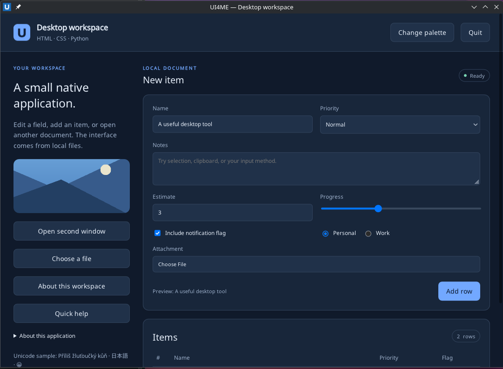

# UI4ME Core for Python

**Build native desktop apps with local HTML and CSS, and write all of the logic in plain Python.** There is no browser, JavaScript engine, Electron, WebKit, Qt or local web server. The wheel bundles a native host, written in Rust, that opens real windows and renders your HTML and CSS itself.

[Documentation](https://github.com/ui4me/ui4me-core/blob/main/docs/index.md) · [Quickstart](https://github.com/ui4me/ui4me-core/blob/main/docs/guides/quickstart-python.md) · [Python API](https://github.com/ui4me/ui4me-core/blob/main/docs/reference/python-api.md) · [Recipes](https://github.com/ui4me/ui4me-core/blob/main/docs/guides/patterns.md) · [Source and issues](https://github.com/ui4me/ui4me-core)



## Install

```bash
uv add ui4me-core
```

or, in a virtual environment:

```bash
python -m pip install ui4me-core
```

You need Python 3.10 or newer on Linux x86-64 (glibc 2.34+, Wayland desktop session) or Windows x64. The platform wheel already contains the native host, so you do not need Rust or a compiler.

## Your first app

Save this as `app.py`:

```python
from ui4me_core import Application

PAGE = """
<main style="font-family: sans-serif; padding: 24px">
  <h1>Hello from Python</h1>
  <label for="name">Your name</label>
  <input id="name" type="text">
  <button id="greet">Greet me</button>
  <p id="message">Type your name and press the button.</p>
</main>
"""


def main():
    with Application.start(name="Hello UI4ME") as app:
        window = app.open_html(PAGE, title="Hello UI4ME", width=520, height=320)
        document = window.document

        def greet(event):
            name = document.get_value("name").strip() or "world"
            document.set_text("message", f"Hello, {name}!")

        document.on("click", greet, element="greet")
        app.run()


if __name__ == "__main__":
    main()
```

Then run it like any other script:

```bash
python app.py
uv run app.py              # in a uv project
python -m mypackage.app    # module form works too
```

**How it starts:** `Application.start()` launches the bundled native host and waits. The host starts the same script a second time as the connected application, and the first process relays its output and exits with the app's exit status. Code above `Application.start()` therefore runs twice, so keep your setup inside `main()` behind `if __name__ == "__main__":`.

## Start from a project template

```bash
ui4me-new my-app --name "My App"
cd my-app
python app.py            # or: uv run app.py
```

The generator writes `app.py`, `index.html`, `style.css`, a `pyproject.toml` for uv, and an optional `app.toml` manifest for launching the host explicitly with `ui4me-host run --app app.toml`.

## What you can build

- **Layouts and styling** from local HTML and CSS: selectors, custom properties, local fonts, flexbox, grid, tables, scrolling and dark mode.
- **Forms and controls:** text fields, checkboxes, radios, selects, buttons, form data, validation and focus.
- **Live updates** of text, values, attributes, classes and HTML fragments, applied singly or as one atomic batch.
- **Desktop features:** multiple windows, native file and folder dialogs, clipboard, opening files and URLs, and desktop preferences.
- **Custom windows:** frameless windows with HTML title bars, and live RGBA bitmaps for previews and visualizations.
- **Accessibility** through the native screen-reader APIs (AT-SPI on Linux, UI Automation on Windows).

Your Python code runs in its own process, so a slow callback never freezes painting, scrolling or text editing. UI4ME implements a focused desktop profile of HTML and CSS, not a full web browser: it runs no `<script>` and loads nothing from the network. See [HTML and CSS support](https://github.com/ui4me/ui4me-core/blob/main/docs/concepts/html-css-scope.md).

## Supported platforms

| Platform | Python |
| --- | --- |
| Linux x86-64, glibc 2.34+, Wayland desktop (qualified on KDE Plasma 6) | 3.10 – 3.14 |
| Windows x64 (qualified on Windows Server 2022) | 3.10 – 3.14 |

macOS, X11 sessions and ARM64 are not supported. See [Platforms](https://github.com/ui4me/ui4me-core/blob/main/docs/guides/platforms.md).

## Coding-agent skill

The package includes a skill that teaches coding agents (Claude Code, Codex, OpenCode, GitHub Copilot, Cursor, Gemini CLI) how to build UI4ME apps:

```bash
ui4me-skill install --agents all
```

## Links

- [Troubleshooting](https://github.com/ui4me/ui4me-core/blob/main/docs/guides/troubleshooting.md)
- [Release notes](https://github.com/ui4me/ui4me-core/blob/main/docs/release/RELEASE_NOTES_1.0.1.md)
- [PowerShell module UI4ME.Core](https://www.powershellgallery.com/packages/UI4ME.Core) (same native host, for PowerShell scripts)
- License: MIT for UI4ME; bundled components keep their own licenses, listed in the wheel's `THIRD_PARTY_LICENSES.txt` and in [THIRD_PARTY_NOTICES.md](https://github.com/ui4me/ui4me-core/blob/main/THIRD_PARTY_NOTICES.md)
